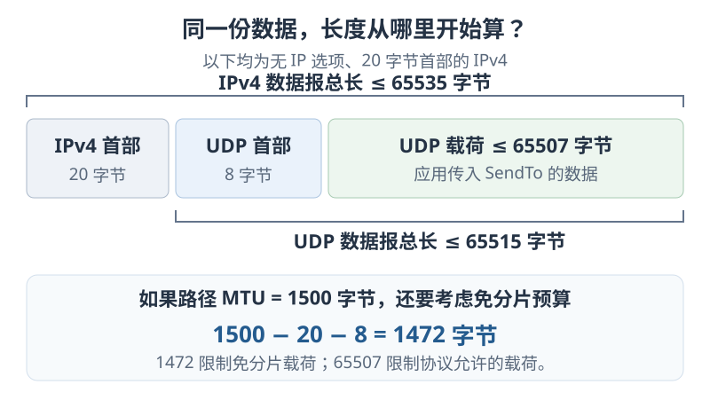

在 C# 中使用 UDP，一次发送 `65535` 字节，可能得到 `SocketError.MessageSize` 异常；在 Windows 上，对应的原生错误码是 `10040`。查找原因时，又经常会看到另一个说法：“UDP 单包最大只能发送 1472 字节。”

这两个数字回答的是不同的问题：**在无 IP 选项的 IPv4 中，65507 字节是单个 UDP 数据报的载荷上限；当路径 MTU 为 1500 字节时，1472 字节是同一条件下不发生 IP 分片的载荷上限。**

理解这个区别，才能判断报文过大时应该修改载荷大小、检查路径，还是调整应用协议，而不是看到错误信息里有“buffer”就先增大缓冲区。

## 先分清“长度”算到了哪一层 {#length-boundaries}

应用调用 `SendTo` 时传入的字节数组，是 **UDP 载荷**。UDP 为它添加 8 字节首部，形成 UDP 数据报；IP 再添加自己的首部，形成 IP 数据报。

```text
IPv4 数据报 = IPv4 首部 + UDP 首部 + UDP 载荷
UDP 数据报  = UDP 首部 + UDP 载荷
```

因此，“UDP 最大长度”至少可能指 UDP 数据报总长或应用载荷长度。讨论时应明确口径。本文以下的“载荷大小”，都指交给 UDP 的应用数据字节数；应用自己添加的序号、时间戳等字段也包含在其中。

<figure class="architecture-figure">
  <a href="/images/posts/udp-length/length-boundaries.svg" target="_blank" rel="noopener"></a>
  <figcaption>先确定统计范围，再比较数字。图中各部分宽度不按字节数比例绘制。</figcaption>
</figure>

UDP 首部中的 `Length` 字段占 16 位，包含 UDP 首部和载荷，最小值为 8。IP 首部不计入 UDP Length，计算校验和时使用的伪首部也不是额外发送的 UDP 首部。[RFC 768](https://www.rfc-editor.org/rfc/rfc768.html)

## 65507 是怎样算出来的 {#ipv4-limit}

IPv4 的 `Total Length` 字段占 16 位，包含 IPv4 首部和数据，最大值为 `65535`。IPv4 首部最短为 20 字节；存在 IP 选项时还会变长。[RFC 791 §3.1](https://www.rfc-editor.org/rfc/rfc791.html#section-3.1)

在**无 IP 选项、IPv4 首部为 20 字节**的条件下，按这些字段定义计算：

| 统计范围 | 计算方式 | 长度上限（字节） |
| --- | --- | :---: |
| 整个 IPv4 数据报 | Total Length 的最大值 | 65535 |
| UDP 数据报：首部＋载荷 | 65535 − 20 | 65515 |
| UDP 载荷：应用传入的数据 | 65535 − 20 − 8 | **65507** |

UDP Length 和 IP 长度字段共同约束报文大小。在这个 IPv4 场景中，**IP 总长度的限制更严格**，所以不能只看 UDP Length 的 16 位，就认为应用能传入 65535 字节。

这里还要补上三个边界：

- 有 IPv4 选项时，需要减去实际 IP 首部长度，载荷上限会下降。
- 普通 IPv6 报文的长度字段定义不同。无扩展首部时，UDP 载荷上限为 `65535 − 8 = 65527` 字节，不能套用 IPv4 的减 20 公式。IPv6 jumbogram 属于特殊机制，本文不展开。[RFC 8085 §2](https://www.rfc-editor.org/rfc/rfc8085.html#section-2)
- 这些是协议格式允许的上限，不保证每个平台、每条路径或每个接收端都能成功交付这么大的数据报。

对本文开头的 IPv4 发送场景来说，65535 字节的应用载荷已经超过 65507 上限。即使允许 IP 分片，也不能绕过这个上限；增大 Socket 缓冲区也不能改变协议字段的长度。

## 1472 又限制了什么 {#path-mtu}

MTU（Maximum Transmission Unit，最大传输单元）描述链路能够承载的 IP 数据报大小，包含 IP 首部，不包含外层以太网首部和帧校验序列。

常见的标准以太网 IP MTU 是 1500 字节。传统无 VLAN 标签的以太网帧，按包含帧校验序列、不含前导码和帧间隙的口径，总长最大为 1518 字节，其中 18 字节是以太网首部和帧校验序列。这是特定帧格式的口径，不应表述为所有以太网帧都不能超过 1518；VLAN 标签、巨帧等情况需要另外区分。[Cisco 巨帧说明](https://www.cisco.com/c/en/us/support/docs/switches/catalyst-6000-series-switches/24048-148.html)

但应用真正关心的是**路径 MTU（PMTU）**：到目标的整条路径所能支持的最大 IP 数据报大小，受途中较小的链路 MTU 限制。仅看到本机网卡 MTU 为 1500，不能证明整条路径都是 1500；隧道封装也可能降低有效 PMTU。[RFC 8085 §3.2](https://www.rfc-editor.org/rfc/rfc8085.html#section-3.2)

在已知 PMTU 的前提下，免分片的 UDP 载荷预算可以按下面的方式计算，并同时满足前文的协议上限：

```text
免分片 UDP 载荷预算 = PMTU − 实际 IP 首部长度 − 8
```

| 条件 | 计算方式 | 免分片载荷上限（字节） |
| --- | --- | :---: |
| PMTU = 1500，IPv4，无 IP 选项 | 1500 − 20 − 8 | **1472** |
| PMTU = 1500，IPv6，无扩展首部 | 1500 − 40 − 8 | **1452** |
| PMTU = 1280，IPv6，无扩展首部 | 1280 − 40 − 8 | **1232** |

IPv6 基本首部为 40 字节；扩展首部会进一步占用空间。表中的数字是按对应条件计算的结果，不是适用于任意网络的固定推荐值。[RFC 8200 §3](https://www.rfc-editor.org/rfc/rfc8200.html#section-3)

如果应用协议还要在 UDP 载荷内放入 16 字节自定义首部，那么在第一行条件下，业务数据最多为 `1472 − 16 = 1456` 字节。

## 超过 MTU 以后会发生什么 {#fragmentation}

先把两种“过大”分开：**超过协议允许的单报文上限，无法靠 IP 分片解决；满足协议上限但超过 PMTU，才涉及分片和路径 MTU 处理。**

对于 IPv4，在允许分片且没有其他限制时，发送端或途中路由器可以把一个 IP 数据报拆成多个 IP 分片。接收端 IP 层收齐后重组，再向 UDP 层交付完整数据报。如果设置了 DF（Don't Fragment），就不能这样分片；过大的报文可能在本机发送时报错，或在途中被丢弃并触发 ICMP 反馈。具体表现取决于系统、已知 PMTU 和网络反馈，不能保证一定在当前这次 `SendTo` 中看到异常。[RFC 791](https://www.rfc-editor.org/rfc/rfc791.html)

例如，**假设在 MTU 为 1500 的 IPv4 链路上分片，且没有 IP 选项**，一个携带 2000 字节 UDP 载荷的数据报总长为 `20 + 8 + 2000 = 2028` 字节，可以拆成：

| IP 分片 | IP 首部 | 该分片承载的内容 | 分片总长（字节） |
| --- | :---: | --- | :---: |
| 第一片 | 20 字节 | UDP 首部 8 字节＋载荷前 1472 字节 | 1500 |
| 第二片 | 20 字节 | 载荷剩余 528 字节 | 548 |

这仍然是**一个 UDP 数据报**，不是两个独立的 UDP 数据报。UDP 首部只在第一片中；接收端重组成功后，应用才有机会读出完整的 2000 字节载荷。任一必要分片缺失，整个数据报都无法完成交付。上表是按协议规则推导的示例，不是本文回环实验的抓包结果。

IPv6 的一个关键区别是：**途中路由器不执行分片，分片只能由源节点完成。** 报文超过下一跳 MTU 时，路由器会丢弃报文并发送 ICMPv6 Packet Too Big；源端需要据此处理报文大小。[RFC 8200 §5](https://www.rfc-editor.org/rfc/rfc8200.html#section-5)

分片还可能受到 NAT、防火墙策略和重组资源的影响。因此，“小于 65507，发送 API 也返回成功”并不能证明它在实际路径上一定能完整送达。[RFC 8085 §3.2](https://www.rfc-editor.org/rfc/rfc8085.html#section-3.2)

## 工程上怎样选择载荷大小 {#choose-size}

对固定设备、固定局域网，可以先确认 IP 版本、实际路径 MTU 和应用首部，再确定载荷预算。希望使用巨帧时，应确认整条路径与两端都支持对应大小，而不只是修改一张网卡。

对未知或可能变化的路径，应使用系统提供的 PMTU 信息，或通过应用协议实现适合数据报传输的路径 MTU 探测。依赖 ICMP 的 PMTUD 可能受过滤影响；DPLPMTUD 可以结合探测报文与交付反馈处理这类情况，但需要协议本身提供相应支持。[RFC 8899](https://www.rfc-editor.org/rfc/rfc8899.html)

如果一条业务消息放不进载荷预算，可以在应用层拆成多个 UDP 数据报，并设计消息编号、分块序号、重组上限、超时清理，以及按业务需要采用的确认或重传机制。**应用层拆包与 IP 分片是两件事**；拆包之后，也需要控制总发送速率。[RFC 8085 §3.2](https://www.rfc-editor.org/rfc/rfc8085.html#section-3.2)

还应分别检查以下三个容量，避免把它们都叫“接收缓冲区”：

| 容量 | 影响的问题 |
| --- | --- |
| 单次 `Receive` 提供的数组长度 | 能否完整装下当前数据报；过小时可能截断或报错，具体取决于 API 与平台 |
| Socket 接收队列容量 | 应用来不及读取时，能暂存多少报文 |
| 应用自己的处理队列容量 | 数据读出后，能承受多少处理积压 |

增大队列有时能吸收突发，但不能扩大协议载荷上限、改变 PMTU，也不能消除持续处理不过来的速率差。

## 用 C# 验证发送边界 {#loopback-experiment}

下面的完整控制台示例使用 .NET 10，显式创建 IPv4 UDP Socket。每次绑定一个本机临时端口，发送一条报文后立即接收；只访问 `127.0.0.1`，不需要实际设备，也不修改网卡配置。

```csharp
using System;
using System.Net;
using System.Net.Sockets;
using System.Runtime.InteropServices;

Console.WriteLine(RuntimeInformation.OSDescription);
Console.WriteLine(RuntimeInformation.FrameworkDescription);

foreach (int size in new[] { 1472, 1473, 65507, 65508, 65535 })
{
    using var receiver = new Socket(
        AddressFamily.InterNetwork, SocketType.Dgram, ProtocolType.Udp);
    receiver.Bind(new IPEndPoint(IPAddress.Loopback, 0));
    receiver.ReceiveTimeout = 1000;

    using var sender = new Socket(
        AddressFamily.InterNetwork, SocketType.Dgram, ProtocolType.Udp);

    string stage = "SendTo";
    try
    {
        int sent = sender.SendTo(new byte[size], receiver.LocalEndPoint!);
        stage = "Receive";
        int received = receiver.Receive(new byte[65535]);
        Console.WriteLine($"{size}: sent={sent}, received={received}");
    }
    catch (SocketException ex)
    {
        Console.WriteLine(
            $"{size}: {stage}, {ex.SocketErrorCode}, native={ex.NativeErrorCode}");
    }
}
```

2026 年 11 月 16 日，在 Windows 10.0.26200、.NET 10.0.11 上的一次实际运行结果如下。其他平台的原生错误码和异常文本可能不同。

| UDP 载荷（字节） | 本次结果 |
| :---: | --- |
| 1472 | 发送 1472，接收 1472 |
| 1473 | 发送 1473，接收 1473 |
| 65507 | 发送 65507，接收 65507 |
| 65508 | `SendTo` 抛出 `MessageSize`，原生错误码 10040 |
| 65535 | `SendTo` 抛出 `MessageSize`，原生错误码 10040 |

Windows 的 `sendto` 文档将超过底层传输所支持消息大小的错误定义为 `WSAEMSGSIZE`。诊断时应记录错误码和失败阶段，不能仅凭一段同时提到发送、接收和缓冲区的异常文本判断原因。[微软 sendto 文档](https://learn.microsoft.com/en-us/windows/win32/api/winsock2/nf-winsock2-sendto)

这个实验验证了本次运行环境下的 IPv4 载荷边界，也说明 **1472 不是 UDP API 的统一发送上限**。但回环路径没有经过物理以太网，不能据此证明真实网口是否分片、DF 是否生效，或者某台设备是否能够接收大报文。验证那些问题需要在实际路径上检查 MTU、Socket 选项和抓包结果。

至于发送 API 成功是否代表对端已经收到，以及接收慢会不会让发送端停发，可以继续看[《UDP 接收慢，会让发送端停发吗？》](/udp-receiver-backpressure-and-ethernet-flow-control/)。长度合法、网络能够传输、应用完成接收，是需要分别验证的条件。
