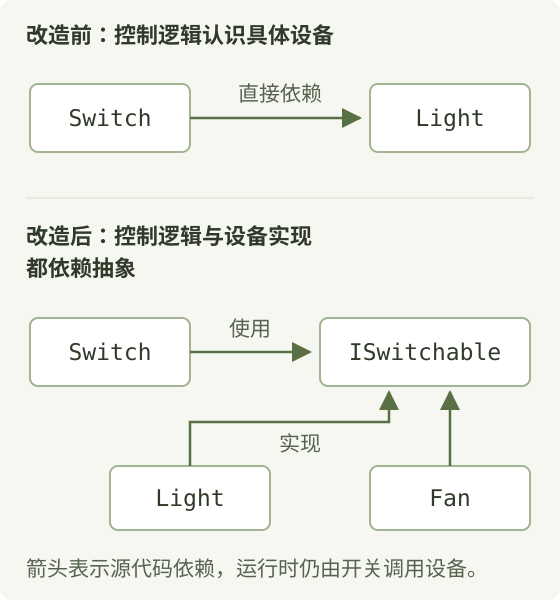
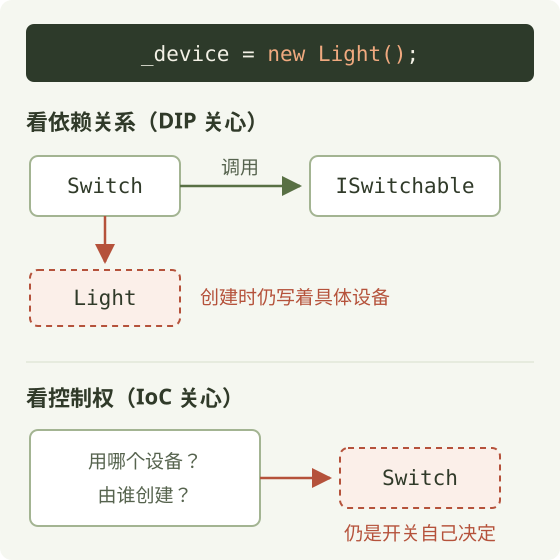
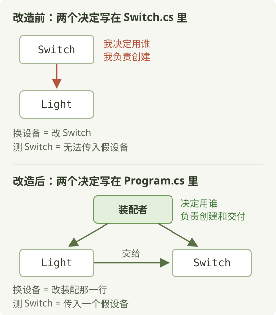

现在写代码，或多或少都在用 AI，确实很快。但代码写出来以后，还有后面的事：AI 帮我写的这段代码，我怎么验证它是对的？过一段时间需求变了，它好不好改？

写得快是一回事，后面能不能改、方不方便测，是另一回事。这篇就围绕这两件事，看代码该怎么组织。

例子很小：一个电源、一个开关、一盏灯。我们用代码实现“开关控制灯”，然后问两个问题——**想让开关控制别的设备，要改哪里？想单独测开关的逻辑，能不能做到**？DIP、IoC、DI 这三个经常被混着用的词，都和这两个问题有关。

先简单认识一下它们各自关心什么，后面再落到代码上：

- **DIP，依赖倒置原则**：关心代码依赖谁。高层流程和具体实现都依赖抽象，抽象本身不依赖实现细节。
- **IoC，控制反转**：关心原来由自己负责的哪些事，现在交给了外面。这篇主要看：设备由谁来选、谁来创建和组装。
- **DI，依赖注入**：一种具体做法。一段代码需要用到的对象，由外面准备好，再传给它。

现在听着可能还有点抽象，下面直接看代码。

## 开关直接控制灯 {#coupled-switch}

```csharp
public class Light
{
    public void TurnOn()  => Console.WriteLine("灯亮了");
    public void TurnOff() => Console.WriteLine("灯灭了");
}

public class Switch
{
    private readonly Light _light = new Light();

    public void Press(bool shouldOn)
    {
        if (shouldOn)
            _light.TurnOn();
        else
            _light.TurnOff();
    }
}
```

`Light` 是灯，提供打开和关闭两个方法。`Switch` 是开关，调用 `Press` 时告诉它要开还是关。

注意字段这一行。开关里保存的对象，类型直接写成了 `Light`，控制设备时调用的也是 `Light` 的方法——**Switch 依赖 Light**。而且，这盏灯是开关自己 `new` 出来的：开关既负责控制灯，也负责把灯创建出来。

这样写很直接，只控制这一盏灯也没有问题。

## 换风扇、做测试，卡在哪里 {#two-questions}

**第一个问题：想把灯换成风扇，要改哪里？**

得改 `Switch`。它的字段类型就是 `Light`，只认识灯。想换成风扇，开关里面的代码就得跟着改。

**第二个问题：我只想测开关有没有发出打开、关闭的调用，能不能给它一个测试用的设备？**

给不进去。创建 `Switch` 时，它就在里面 `new Light()`，没有任何入口能把设备从外面传进去。

两个问题卡在同一行代码上，但卡住的是两件事：**开关依赖的是哪个类型，设备又是由谁创建的**。现在开关只认识 `Light`，灯也是它自己创建的，换设备和做测试都受到了限制。

## 按开关的需要定义接口 {#interface}

怎么改，才能让这个开关既能控制灯，也能控制风扇？

先看开关需要设备做什么：其实就两件事，打开、关闭。把这两个方法写成一个接口：

```csharp
public interface ISwitchable
{
    void TurnOn();
    void TurnOff();
}

public class Light : ISwitchable { /* 灯亮了、灯灭了 */ }
public class Fan   : ISwitchable { /* 风扇转了、风扇停了 */ }

public class Switch
{
    private readonly ISwitchable _device = new Light();

    public void Press(bool shouldOn)
    {
        if (shouldOn)
            _device.TurnOn();
        else
            _device.TurnOff();
    }
}
```

**这个接口表达的是开关的需要**。开关要求你能打开、能关闭；打开以后是灯亮了还是风扇转了，由设备自己实现。

这里有个值得注意的变化：以前是灯提供什么方法，开关就照着调用；现在是先确定开关需要什么，再让设备来实现。这个变化，和依赖倒置有什么关系？

## DIP 要求的依赖关系 {#dip}

以前，开关依赖灯。灯的方法长什么样，开关就得照着调——开关迁就灯。

DIP 希望改成下面这样：**开关只依赖它需要的接口，灯和风扇来实现这个接口**，具体设备反过来迁就开关需要的标准。“倒置”倒的就是这个关系：以前高层直接依赖具体设备，现在具体设备实现高层需要的抽象。

<figure class="architecture-figure">
  <a href="/images/posts/who-depends-on-whom/dependencies.svg" target="_blank" rel="noopener"></a>
  <figcaption>箭头表示源代码依赖。程序运行时，仍然是开关调用灯或风扇。</figcaption>
</figure>

完整地看，DIP 有两条要求：

1. 高层和具体实现都依赖抽象，高层不再直接依赖那个具体设备。
2. 抽象本身也不能依赖具体实现。比如接口的方法如果要求传入一个 `Light` 对象，使用这个接口的代码就还是得认识具体的灯。

那刚才的开关，是不是已经做到了？

## 有了接口，还差一步 {#still-new}

现在有接口了，灯能实现，风扇也能实现。那我要接风扇，怎么接？

还是得改开关。字段那一行还写着 `new Light()`，想换风扇，就得回来把它改成 `new Fan()`。

所以 `Switch` 同时依赖接口和具体的 `Light`。通过接口调用，只改掉了调用这一边；创建时的具体依赖还在。按 DIP 的要求，**这里仍然违背 DIP**。

很多讲解讲到“有了接口”这一步就结束了，接着说这就是控制反转。其实还差一步，这也是 DIP 和 IoC 那么容易被混着用的原因。同一行代码，可以从两个角度看：

<figure class="architecture-figure">
  <a href="/images/posts/who-depends-on-whom/same-line-two-views.svg" target="_blank" rel="noopener"></a>
  <figcaption>DIP 关注上半部分的依赖关系，IoC 关注下半部分的控制权。</figcaption>
</figure>

- **看依赖关系**：`Switch` 还依赖具体的 `Light`。这是 DIP 关心的。
- **看控制权**：用什么设备、谁来创建，还是 `Switch` 自己决定。这是 IoC 关心的。

差的就是把这行具体设备的创建移出去。移出去以后，`Switch` 不再依赖 `Light`，选设备、创建设备的控制权也交给了外面。一次修改，两个问题一起解决。

## 设备交给外面准备 {#external-assembly}

原来是 `Switch` 自己创建灯，现在改成从构造函数接收一个设备：

```csharp
public class Switch
{
    private readonly ISwitchable _device;

    public Switch(ISwitchable device)
    {
        _device = device ?? throw new ArgumentNullException(nameof(device));
    }

    public void Press(bool shouldOn)
    {
        if (shouldOn)
            _device.TurnOn();
        else
            _device.TurnOff();
    }
}

// Program.cs
var lightSwitch = new Switch(new Light());
var fanSwitch   = new Switch(new Fan());
```

参数类型是 `ISwitchable`，传进来的设备保存在 `_device` 里。`Switch` 只需要认识接口，里面**不再出现 `Light`、`Fan` 这些具体类型**了。最后两行，一个传入灯，一个传入风扇，用的是同一个 `Switch` 类，换设备时类里的代码不用跟着改。

那谁来 `new` 这个灯、谁把它交给开关？就是 `Program.cs` 里这两行。它先把设备准备好，再把设备和开关组到一起。我们给这个角色起个名字，叫**装配者**。装配的活之前藏在 `Switch` 里，现在被拎了出来。`new Light()` 并没有消失——系统总得有地方认识和创建具体设备——只是挪到了装配者那里。

外面准备好设备，再通过构造函数交进去，这个做法就叫**依赖注入，DI**。

现在从三个角度看这次修改：

| 角度 | 这次修改中的体现 |
| --- | --- |
| DIP | `Switch` 只依赖接口，设备实现这个接口，接口里也没有设备细节 |
| IoC | 选什么设备、谁创建和组装，交给了外面的装配者 |
| DI | 设备通过构造函数传进来 |

三个名字，说的其实都是同一次修改：**开关接收接口类型的设备，设备在外面准备好，再传进来。**

## 设备的决定挪到了哪里 {#decisions}

把修改前后放在一起，只看两件事：**用哪个设备，谁来创建**。

<figure class="architecture-figure">
  <a href="/images/posts/who-depends-on-whom/decisions-moved.svg" target="_blank" rel="noopener"></a>
  <figcaption>设备的选择和装配挪到外面，Switch 只负责使用。</figcaption>
</figure>

以前，`Switch` 自己选择灯，也自己创建灯，所以换设备要改 `Switch`，测试代码也没法把假设备传进去。现在这两件事由装配代码负责：以后换风扇，改装配那一行；想测开关，就传入一个假设备。

控制设备的逻辑留在 `Switch` 里，选择和创建设备的事情交给装配者。

## 放到扫描系统：主流程与转台 {#rts}

开关的例子改好了。放到一个设备扫描系统里，看扫描主流程怎么使用转台。

开关需要设备能打开、关闭，所以定义了 `ISwitchable`。扫描主流程也一样：它需要转台转到指定角度，所以按这个需要定义 `ITurntable`，只约定一个方法。

```csharp
public interface ITurntable
{
    Task MoveToAsync(double angle);
}

public class ScanFlow
{
    private readonly ITurntable _turntable;

    public ScanFlow(ITurntable turntable) => _turntable = turntable;

    public async Task RunAsync(IEnumerable<double> angles)
    {
        foreach (var angle in angles)
        {
            await _turntable.MoveToAsync(angle);
            // 到位后采集数据……
        }
    }
}

// 装配入口：用哪家的转台，在这里决定
var scan = new ScanFlow(new VendorATurntable());
```

扫描主流程从构造函数接收一个 `ITurntable`，扫描时依次调用 `MoveToAsync`。至于是哪家公司的转台、内部怎么控制，它不用管。各家转台的适配器实现 `ITurntable`，具体怎么调用厂家 SDK，留在适配器内部。用哪家的转台，由装配代码决定；换成厂家 B，就在装配那里修改。

**扫描主流程负责使用转台，适配器负责对接设备，装配代码负责把具体实现准备好、传进来。**

## 依赖从哪里传进来 {#injection-styles}

前面传入依赖，用的都是构造函数。常见的还有属性注入和方法注入：

```csharp
// 构造函数注入
public Switch(ISwitchable device) { _device = device; }

// 属性注入
public ISwitchable Device { get; set; }
sw.Device = new Light();   // 用之前要记得赋值……

// 方法注入
public void Press(ISwitchable device, bool shouldOn) { /* … */ }
```

| 方式 | 适用 | 注意 |
| --- | --- | --- |
| 构造函数注入（推荐） | 对象一直需要的依赖，创建时传入 | 提前准备好依赖，并校验空值与有效性 |
| 属性注入 | 创建后赋值，可用于可选依赖 | 可能漏赋值；未赋值时要有默认行为或报错 |
| 方法注入 | 调用时传入，仅本次调用使用 | 每次都要提供；要确认能否传入不同对象 |

它们本质上一样：由外面把准备好的对象交给需要它的代码，区别在什么时候传进来、怎么使用。为了减少漏赋值、使用顺序这类问题，**对象一直需要的依赖，优先用构造函数注入**。

## 没有真设备，也能测开关 {#testing}

回到开头的第二个问题：不连接真实设备，能不能先测开关的逻辑？

可以创建一个假设备，只记录现在是开着还是关着：

```csharp
public class FakeDevice : ISwitchable   // 一个“假灯”，只记录状态
{
    public bool IsOn { get; private set; }
    public void TurnOn()  => IsOn = true;
    public void TurnOff() => IsOn = false;
}

[Fact]
public void Press_On_ShouldTurnDeviceOn()
{
    var fake = new FakeDevice();
    var sw   = new Switch(fake);      // 把假设备注入进去

    sw.Press(true);

    Assert.True(fake.IsOn);           // 验证的是开关的逻辑，不是灯
}
```

把假设备传给开关，调用 `Press(true)`，再断言假设备变成了打开状态。

注意，这个测试**验证的是开关逻辑，而不是真实灯的运行情况**。真实设备能不能打开，仍需要另外验证。能这样测，靠的就是：依赖的设备从外面传进来，测试代码就能给开关一个测试用的实现。换设备和做测试，用的是同一个入口。

## IoC 还在回调和框架里 {#ioc-elsewhere}

前面把选设备、创建和组装交给外面的装配者，体现了 IoC。IoC 还有另外两种常见的情况：

```csharp
// 回调 / 事件：芯片 SDK 帧完成时调你；CAN 卡收到报文时调你
sdk.OnFrameReady(f => Process(f));
can.MessageReceived += OnMessage;

// 框架 / 模板方法：单元测试框架
abstract class TestCase
{
    public void Run()
    {
        Setup();
        Execute();
        Teardown();
    }
    protected abstract void Execute();   // 你只写 Execute，Run 是框架的
}
```

| 形式 | 交出去的是什么 |
| --- | --- |
| 依赖注入 | 用什么对象：对象由外部创建和装配 |
| 回调 / 事件 | 什么时候被调用：处理逻辑是你的，调用时机是 SDK 或驱动的 |
| 框架 / 模板方法 | 执行步骤：你实现 `Execute`，按什么顺序调用由框架安排 |

所以说 IoC 时，要说清楚**到底是哪部分控制权交给了外面**。

## 容器帮忙完成装配 {#container}

前面的灯和风扇，是手工装配的：`new Switch(new Light())`。对象少的时候，手动创建再传进去很简单。但对象之间的依赖变复杂以后，还要管理对象的共享、创建和释放，维护成本就高了。这时 DI 容器就派上用场了。

**DI 容器也常叫 IoC 容器，说的是同一个东西**。它帮我们完成对象的创建和装配，以及生命周期管理。在 .NET 里大致是这样：

```csharp
var services = new ServiceCollection();
services.AddTransient<ISwitchable, Light>();
services.AddTransient<Switch>();

using var provider = services.BuildServiceProvider();
var sw = provider.GetRequiredService<Switch>();
```

容器只是帮我们做装配，接口还是要自己设计。系统里要不要用容器、什么时候用，值得仔细考虑；对象不多时，手工装配往往更容易看懂。

## C 里的关联算法怎么接 {#c-functions}

开关的例子是用 C# 写的。其实 DIP、IoC、DI 并不局限于某种语言，换一种语言，写法会变，**处理依赖的思路仍然适用**。

比如用 C 写跟踪主循环，需要在 NN 和 GNN 之间选择关联算法：

```c
/* 接口：就是一个函数指针类型 */
typedef void (*associate_fn)(tracks_t *tracks, dets_t *dets);

/* 实现：nn.c / gnn.c 各一个 */
void nn_associate (tracks_t *t, dets_t *d) { /* ... */ }
void gnn_associate(tracks_t *t, dets_t *d) { /* ... */ }

/* 调用方 tracker.c：只认接口，不 include nn.h / gnn.h */
static associate_fn associate;
void tracker_init(associate_fn fn) { associate = fn; }
void tracker_step(tracks_t *tracks, dets_t *dets)
{
    associate(tracks, dets);
    /* 根据关联结果更新航迹…… */
}

/* 装配者 main.c */
tracker_init(gnn_associate);
```

函数指针类型约定了关联函数接收哪些参数，NN 和 GNN 各自提供符合约定的函数。初始化时，`main.c` 选一个关联函数传给 `tracker_init` 保存；之后跟踪主循环需要做关联，就调用保存的函数。

**用 NN 还是 GNN，由外面决定**，跟踪主循环只通过约定好的函数签名调用。对应到开关，就是外面选好设备，再传给使用它的代码。

如果规范或场景不允许运行时传函数指针，还有两种常见做法：构建时选择——头文件声明统一入口，由构建脚本只链接一个实现；或者按场景分发——传入一个分发函数，内部选择 NN 或 GNN，对外仍是同一个签名。

## 用三个问题来判断 {#three-questions}

看过这些例子，再遇到代码时，可以分别问三个问题：

| 概念 | 问什么 |
| --- | --- |
| DIP | 代码依赖什么？是抽象还是具体实现？抽象里有没有带进实现细节？ |
| IoC | 哪些事情交给外面负责了？选设备、创建设备，还是回调的调用时机？ |
| DI | 需要的对象或函数，是不是由外面传进来的？ |

再记住一个反例：

```csharp
public Switch(Light light) { _light = light; }
```

灯是从外面传进来的，用了 DI；但参数类型还是 `Light`，开关仍然依赖具体的灯。所以，**有 DI，不代表就满足 DIP**。

## 练一练：三种写法 {#exercise}

下面三种写法，试着分别判断：是否满足 DIP、是否体现了 IoC、有没有使用 DI，并说出依据。如果觉得信息不足以判断，也想想还需要看什么。

1. 扫描主流程里写着一行：`ITurntable tt = new VendorATurntable();`
2. 跟踪主循环在 `tracker_init` 里收到一个函数指针，自己不 `include` nn.h / gnn.h，用哪个由 `main.c` 决定。
3. 信号处理把 chirp 数从 384 改成 512，是通过配置文件传进去的。

<details class="reading-exercise">
  <summary>第 1 种的判断</summary>
  <p>虽然通过接口调用，但扫描主流程里仍然 <code>new</code> 厂家 A 的转台，还是依赖具体类型，换厂家 B 还得改扫描主流程。这和 <code>Switch</code> 里保留 <code>new Light()</code> 是同一个问题：还没有满足 DIP，设备也不是从外面传进来的。</p>
</details>

<details class="reading-exercise">
  <summary>第 2 种的判断</summary>
  <p>函数从初始化入口传进来，这是 DI；用哪个函数由 <code>main.c</code> 决定，体现了 IoC。如果跟踪主循环依赖的是不含具体实现细节的函数签名，也符合 DIP 的要求。</p>
</details>

<details class="reading-exercise">
  <summary>第 3 种的判断</summary>
  <p>只知道 chirp 数通过配置从 384 改成了 512，还判断不了有没有使用 DI，也看不出依赖关系和控制权是怎么安排的。还得继续看：配置由谁读取，又是怎么交给算法的。如果算法自己去读配置文件，配置的获取仍是它自己的事；如果外面读好配置、构造配置对象再传给算法，这也可以是依赖注入。不能只凭一个配置值变了就下结论。</p>
</details>

## 回到开关 {#summary}

回到开关控制灯这个例子，我们最后做的修改其实很明确：**开关通过接口使用设备，具体设备由外面准备好，再传进来。**

- 看依赖关系，开关依赖抽象，符合 **DIP** 依赖倒置原则的要求。
- 看设备由谁选择和创建，这些事情交给了外面，体现了 **IoC** 控制反转思想。
- 外面把设备传给开关，用的做法就是 **DI** 依赖注入。

回去看自己的代码时，也可以这样找：**设备或算法是在哪里选的、在哪里创建的，又是怎么交给使用它的代码的？**

## 附：几个例子里的角色 {#roles}

三个例子放在一起对照。先找到使用依赖的代码，再找到选择和装配依赖的代码。

| 角色 | 开关 | 扫描系统 | 跟踪算法（C） |
| --- | --- | --- | --- |
| 调用方 | `Switch` | 扫描主流程 | `tracker_step()` |
| 抽象 | `ISwitchable` | `ITurntable` | `associate_fn` |
| 实现 | `Light`、`Fan` | 厂家 A、厂家 B | `nn_associate`、`gnn_associate` |
| 测试替身 | `FakeDevice` | 记录角度的假转台 | 返回固定关联结果的函数 |
| 装配者 | `Program.cs` | 装配入口 | `main.c` / 构建脚本 |
| 使用场景 | 控制设备 | 换设备、测流程 | 选算法、测跟踪主循环 |

## 附：接口还要设计得合适 {#interface-design}

把具体类型换成接口以后，接口的参数和功能怎么设计，也会影响后面换设备、换算法。

- **接口里别带厂家专用类型**。接口是我们定义的，参数里却带着厂家 A 的句柄，使用接口的代码就还得认识这家公司的类型。厂家句柄应该留在适配器内部，接口使用业务需要的类型。
- **设备能力要匹配**。把单轴、双轴转台的功能都塞进一个大接口，单轴设备就会被迫实现自己做不到的方法。可以按能力拆成更小的接口，让扫描主流程只依赖它需要的部分。
- **算法的输入输出要够用**。原来的接口只给出最终配对结果，新算法却需要更多信息，原接口就不够用了。这时要重新约定接口的输入、输出和职责。

接口要表达调用方真正需要的能力，实现之间的差异尽量留在适配器里面。

---

**示例代码**：[完整 C# 示例与 xUnit 测试](https://github.com/luli100/luli100.github.io/tree/main/examples/who-depends-on-whom)，包含开关、灯、风扇和假设备，用 .NET 8 SDK 运行 `dotnet test`。

**延伸阅读**：

- Robert C. Martin：[Design Principles and Design Patterns](https://staff.cs.utu.fi/~jounsmed/doos_06/material/DesignPrinciplesAndPatterns.pdf)，DIP 的出处。
- Martin Fowler：[Inversion of Control Containers and the Dependency Injection pattern](https://www.martinfowler.com/articles/injection.html)，“依赖注入”这个名字的来历。
- Microsoft Learn：[.NET dependency injection](https://learn.microsoft.com/en-us/dotnet/core/extensions/dependency-injection/overview)，.NET 容器的用法。
