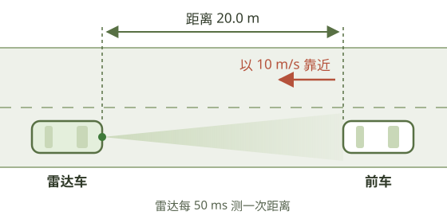
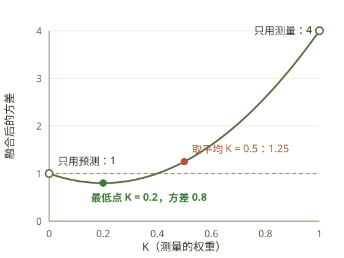

雷达车跟踪前车，每 50 ms 测一次距离。测量有噪声，前车也不一定匀速。怎样把"按运动规律推算的距离"和"雷达测到的距离"合成一个更准的值？

<figure class="architecture-figure">
  
  <figcaption>雷达车跟踪前车。图中只有已知条件，预测和测量的结果在对话中逐步得出。</figcaption>
</figure>

本文以师生对话的形式，从这个场景一步步推导出一维卡尔曼滤波。只估计距离，速度视为已知，速度的估计留到下一篇。读懂全文只需要知道方差的含义和简单的求导。

## 50 ms 后，前车在哪 {#prediction}

**老师：**看开头这张图。雷达车装有毫米波雷达，正在跟踪正前方的一辆车，雷达每 50 ms 出一帧。假设此刻已经知道：前车距离雷达车 20.0 m，正以 10 m/s 的速度向雷达车靠近。下一帧，也就是 50 ms 之后，前车离雷达车多远？

**学生：**50 ms 内会靠近 $$10 \times 0.05 = 0.5$$ m，所以是 19.5 m。

**老师：**对。为了让公式统一，我们约定速度 $$v$$ 是**距离的变化率**：负值表示靠近，正值表示远离。这里 $$v = -10$$ m/s，刚才的计算写成：

$$
20.0 + (-10) \times 0.05 = 19.5\ \text{m}
$$

用运动规律把当前状态推到下一时刻，这一步叫做**预测**。写成通式就是：

$$
\hat{x}_{\text{预测}} = \hat{x} + v\,\Delta t
$$

$$\hat{x}$$ 上的"帽子"表示这是**估计值**，不是真值。

**学生：**速度带上符号，靠近和远离就是同一个公式，不用再纠结该加还是该减。

**老师：**那么，50 ms 后前车一定在 19.5 m 吗？

**学生：**不一定。20.0 m 和 10 m/s 本身就是估计出来的，可能有误差。前车在这 50 ms 里也可能轻踩刹车，或者加速。

**老师：**对。所以 19.5 m 只是"应该在那里"，还需要新的观测来核对。

## 两个数不一样，该信谁 {#which}

**老师：**50 ms 后，雷达的新一帧到了，测得距离 19.8 m。这个数就是答案吗？

**学生：**也不一定。雷达测距有噪声，比如接收机的热噪声、车身上反射点的变化。就算目标停着不动，每一帧的读数也会在真实距离上下跳动（噪声从哪里来？见文末[常见疑问](#faq)）。

**老师：**所以现在手上有两个数，都不完全可靠，而且相差 0.3 m：

| 来源 | 距离 | 不准的原因 |
| --- | --- | --- |
| 预测 | 19.5 m | 当前估计有误差，前车不一定匀速 |
| 测量 | 19.8 m | 雷达测距噪声 |

这一帧，你会输出多少米？

**学生：**取平均吧，19.65 m。

**老师：**这个做法已经有了卡尔曼滤波的骨架：**预测 → 测量 → 融合**。不过取平均隐含了一个选择：两边各信一半。看两种极端情况：

- **情况 A**：雷达误差只有 ±1 cm，前车却是新手，经常突然刹车加速。
- **情况 B**：雷达测距经常跳动 ±1 m，前车开着定速巡航，速度非常稳定。

这两种情况下，你还会各信一半吗？

**学生：**不会。情况 A 雷达很准，应该更信雷达；情况 B 雷达很差，前车又很稳，应该更信预测。

**老师：**你刚才说出了卡尔曼滤波最核心的思想：

> **谁的不确定性小，就更相信谁。**

## "更相信"怎么变成数字 {#gain}

**老师：**"更相信"还只是直觉，要让计算机去做，得变成数字。取平均其实是加权和的特例：两边各乘 0.5 再相加。一般地，可以写成：

$$
\hat{x} = w_1\,\hat{x}_{\text{预测}} + w_2\,z
$$

$$z$$ 是测量值。两个权重有什么限制吗？

**学生：**加起来要等于 1。如果都取 0.6，结果是 $$0.6 \times 19.5 + 0.6 \times 19.8 = 23.58$$ m，比两个数都大，显然不对。

**老师：**对。所以只需要一个数：令测量的权重为 $$K$$，预测的权重就是 $$1-K$$：

$$
\hat{x} = (1-K)\,\hat{x}_{\text{预测}} + K\,z
$$

$$K$$ 在 0 到 1 之间，取平均就是 $$K = 0.5$$。

再用两个数描述"有多不靠谱"：$$P_{\text{预测}}$$ 是预测的不确定度，$$R$$ 是测量的不确定度，数字越大越不靠谱。具体用什么量来衡量，我们后面再精确定义，先把它们当成"不靠谱的程度"。你能只用 $$P_{\text{预测}}$$ 和 $$R$$ 设计一个 $$K$$ 吗？它至少要满足：

| 情况 | 期望的 $$K$$ | 含义 |
| --- | --- | --- |
| $$R = 0$$，雷达完美 | 1 | 完全相信测量 |
| $$P_{\text{预测}} = 0$$，预测完美 | 0 | 完全相信预测 |
| $$P_{\text{预测}} = R$$ | 0.5 | 退回平均 |

**学生：**没什么头绪。

**老师：**$$K$$ 本质上是一个比例。设 $$P_{\text{预测}} = 3$$、$$R = 1$$，总共 4 份不确定性。预测越不靠谱，就越该转向测量。$$K$$ 应该等于谁所占的比例？

**学生：**预测占 3 份，所以 $$K = 3/4$$。

**老师：**换成字母呢？

**学生：**

$$
K = \frac{P_{\text{预测}}}{P_{\text{预测}} + R}
$$

**老师：**用上面三个条件验证一下。

**学生：**$$R = 0$$ 时 $$K = 1$$，$$P_{\text{预测}} = 0$$ 时 $$K = 0$$，$$P_{\text{预测}} = R$$ 时 $$K = 0.5$$，都满足。

**老师：**这个公式可以用一句话记住：

> **预测越不靠谱，就越听测量的。**

## 融合之后，还有多不确定 {#fused-variance}

**老师：**雷达每 50 ms 来一帧，下一帧还要再融合一次，那时需要知道当前估计有多不靠谱。融合后的不确定度，和 $$P_{\text{预测}}$$、$$R$$ 相比，是比两者都大、介于两者之间，还是比两者都小？

**学生：**介于两者之间吧。

**老师：**看 $$P_{\text{预测}} = R$$ 的情况。如果介于两者之间，它就只能正好等于 $$P_{\text{预测}}$$，多了一份信息却一点也没变得更确定。换个生活化的说法：用两把精度相同、误差互不相关的尺子各量一次，取平均。平均值比只量一次更可靠，还是一样可靠？

**学生：**更可靠。一次可能偏大，另一次可能偏小，平均时会部分抵消。这么说，融合后应该比两者都小。

**老师：**对。要算出具体是多少，得先把"不靠谱的程度"精确定义。雷达手册上写的"测距误差 0.3 m"，通常指的是**标准差**，也就是误差通常偏离多少。卡尔曼滤波里的 $$P_{\text{预测}}$$ 和 $$R$$ 用的是**方差**，也就是标准差的平方，比如 $$0.3^2 = 0.09\ \text{m}^2$$。之所以用方差，是因为独立误差叠加时，方差可以直接相加，标准差不行。

注意，方差描述的是误差"通常有多大"，而不是某一次的具体误差。

**学生：**为什么不能直接说某一次的误差是多少？

**老师：**因为误差是"估计值减真值"，而对于距离这样的连续物理量，我们永远无法知道真值。雷达再精确，测出的也只是一个带误差的数。我们能知道的，只有误差通常有多大，也就是方差。这也是卡尔曼滤波要做"估计"的原因：真值拿不到，只能尽量逼近它，并说清楚还差多少。

回到加权和 $$\hat{x} = (1-K)\,\hat{x}_{\text{预测}} + K\,z$$。因为 $$(1-K) + K = 1$$，两边同时减去真值 $$x$$，误差也是同样的加权和（为什么？见文末[常见疑问](#faq)）：

$$
\hat{x} - x = (1-K)\,(\hat{x}_{\text{预测}} - x) + K\,(z - x)
$$

右边两项分别是预测误差和测量误差。两者互相独立时，加权和的方差等于系数的平方乘以各自的方差（为什么？同样见[常见疑问](#faq)）：

$$
P_{\text{新}} = (1-K)^2\,P_{\text{预测}} + K^2\,R
$$

**学生：**两把尺子就是 $$K = 0.5$$、$$P_{\text{预测}} = R = \sigma^2$$，得到 $$\tfrac14\sigma^2 + \tfrac14\sigma^2 = \tfrac12\sigma^2$$，方差减半。

**老师：**对。那么，只要误差独立，融合就一定比只用其中一个更好吗？

**学生：**应该是吧。

**老师：**取 $$P_{\text{预测}} = 1$$（预测较准）、$$R = 4$$（雷达较差），$$K$$ 取几个值试试：

| $$K$$ | $$P_{\text{新}}$$ | 和只用预测比 |
| --- | --- | --- |
| 0 | 1.00 | 一样，等于没用雷达 |
| 0.2 | **0.80** | 更好 |
| 0.5 | 1.25 | **更差** |
| 1 | 4.00 | 差很多，等于只用雷达 |

**学生：**$$K = 0.5$$ 也就是取平均，结果反而不如只用预测。看来误差独立只保证能写出这个公式，结果好不好，要看 $$K$$ 怎么选。

## 为什么偏偏是 P/(P+R) {#optimal}

**老师：**表里 $$K = 0.2$$ 最好。用 $$P_{\text{预测}}/(P_{\text{预测}}+R)$$ 算一下，这时 $$K$$ 是多少？

**学生：**$$1/(1+4) = 0.2$$，正好一样。这是为什么？

**老师：**把表里的情况画成曲线看看：

<figure class="architecture-figure">
  
  <figcaption>预测方差为 1、测量方差为 4 时，融合后的方差随测量权重 K 的变化。虚线是只用预测时的方差。</figcaption>
</figure>

$$K$$ 从 0 开始增大，$$P_{\text{新}}$$ 先下降，到 $$K = 0.2$$ 降到最低，再往后又上升。最低点的特征是：曲线在那里是平的，斜率为 0。所以对 $$K$$ 求导，令导数为 0：

$$
\frac{dP_{\text{新}}}{dK} = -2(1-K)P_{\text{预测}} + 2KR = 0
$$

整理得：

$$
KR = (1-K)P_{\text{预测}} \quad\Rightarrow\quad K = \frac{P_{\text{预测}}}{P_{\text{预测}}+R}
$$

中间那个等式的含义是：$$K$$ 每增大一点，测量误差的贡献就增加，预测误差的贡献就减少；在最优点，两者的增减正好抵消。

**学生：**所以 $$P_{\text{预测}}/(P_{\text{预测}}+R)$$ 不只是凑出来满足三个条件，它让融合后的方差最小。

**老师：**对。其实满足那三个条件的公式不止一个，比如 $$P_{\text{预测}}^2/(P_{\text{预测}}^2+R^2)$$ 也满足。那三个条件只能排除明显错误的公式，真正确定 $$K = P_{\text{预测}}/(P_{\text{预测}}+R)$$ 的，是"方差最小"。卡尔曼滤波被称为最优估计，指的就是这一点。严格来说，"最优"还依赖线性模型和高斯噪声等前提。

再把最优 $$K = P_{\text{预测}}/(P_{\text{预测}}+R)$$ 代回融合方差的一般式 $$P_{\text{新}} = (1-K)^2 P_{\text{预测}} + K^2 R$$。先算出 $$1-K = R/(P_{\text{预测}}+R)$$，于是：

$$
P_{\text{新}} = \frac{R^2}{(P_{\text{预测}}+R)^2}\,P_{\text{预测}} + \frac{P_{\text{预测}}^2}{(P_{\text{预测}}+R)^2}\,R = \frac{P_{\text{预测}} R}{P_{\text{预测}}+R} = (1-K)\,P_{\text{预测}}
$$

教材里常见的 $$P_{\text{新}} = (1-K)P_{\text{预测}}$$，就是一般式在最优增益下的化简结果。

**老师：**$$R = 0$$ 时，$$P_{\text{新}}$$ 是多少？合理吗？

**学生：**是 0。一开始我觉得不合理，以为雷达完美时，$$P_{\text{预测}}$$ 应该变成无穷大。后来想明白了：$$P_{\text{预测}}$$ 是融合**之前**预测的不确定度，不会因为雷达好坏而改变。雷达完美时，融合结果就是真值，当然没有任何不确定性。

**老师：**对。"完全不信预测"是靠 $$K = 1$$ 实现的，不需要 $$P_{\text{预测}}$$ 变成无穷大。

## 到了下一帧，不确定度会怎样 {#predict}

**老师：**融合完进入下一帧，先用运动模型往前推 50 ms。推完之后，不确定度是保持不变、变大，还是变小？

**学生：**变大。模型假设匀速，但前车可能在这 50 ms 里加速或减速。

**老师：**模型没考虑到的这部分变化，用 $$Q$$ 表示。上一帧融合后的方差是 $$P_{\text{新}}$$，推到这一帧：

$$
P_{\text{预测}} = P_{\text{新}} + Q
$$

$$Q$$ 叫**过程噪声**，$$R$$ 叫**测量噪声**。它们是使用卡尔曼滤波时最需要自己设定的两个参数。回到情况 A 和情况 B，$$Q$$ 应该设大还是设小？如果帧周期从 50 ms 变成 200 ms 呢？

**学生：**情况 A 前车经常急刹急加，$$Q$$ 设大；情况 B 稳定巡航，$$Q$$ 设小。帧周期变长，预测的跨度更大，偏离得更多，$$Q$$ 也应该变大。

**老师：**在把它们组装起来之前，先把加权和展开整理一下：

$$
\hat{x} = (1-K)\,\hat{x}_{\text{预测}} + K\,z = \hat{x}_{\text{预测}} + K\,(z - \hat{x}_{\text{预测}})
$$

右边这种写法，你怎么理解？

**学生：**从预测出发，测量和预测差了多少，就按比例 $$K$$ 采纳多少，用来修正预测。比如开头的例子，差值是 0.3 m，$$K = 0.5$$ 时就修正 0.15 m，得到 19.65 m。

**老师：**对。括号里的 $$z - \hat{x}_{\text{预测}}$$ 是测量和预测的差，叫做**测量残差**。在卡尔曼滤波的教材里，它有一个专门的名字：**新息**（innovation），意思是测量带来的、预测无法事先知道的新信息。这种写法和加权和完全等价，但直接体现了"用测量修正预测"，教材和多维卡尔曼滤波都用这种写法。

到这里，一维卡尔曼滤波的所有零件都有了：预测、融合，再进入下一帧。

**学生：**可是每一帧都要做一遍。上一帧的"新"，到这一帧又成了预测的起点。只用"预测""新"这样的标签，很快就分不清是哪一帧的量了。

**老师：**所以要给每个量加上时间下标。$$\hat{x}_{n\vert n-1}$$ 读作"第 $$n$$ 帧的估计，只用到第 $$n-1$$ 帧为止的测量"：

| 记号 | 含义 | 对应前面的写法 |
| --- | --- | --- |
| $$\hat{x}_{n\vert n-1}$$、$$P_{n\vert n-1}$$ | 第 $$n$$ 帧的**预测**，还没用第 $$n$$ 帧的测量 | $$\hat{x}_{\text{预测}}$$、$$P_{\text{预测}}$$ |
| $$\hat{x}_{n\vert n}$$、$$P_{n\vert n}$$ | 第 $$n$$ 帧的**更新**，用上了第 $$n$$ 帧的测量 | $$\hat{x}$$、$$P_{\text{新}}$$ |
| $$z_n$$ | 第 $$n$$ 帧的测量 | $$z$$ |
| $$K_n$$ | 第 $$n$$ 帧的增益 | $$K$$ |

这样，每一帧依次做两步：

**① 预测**

$$
\begin{aligned}
\hat{x}_{n\vert n-1} &= \hat{x}_{n-1\vert n-1} + v\,\Delta t \\
P_{n\vert n-1} &= P_{n-1\vert n-1} + Q
\end{aligned}
$$

**② 更新**

$$
\begin{aligned}
K_n &= \frac{P_{n\vert n-1}}{P_{n\vert n-1} + R} \\
\hat{x}_{n\vert n} &= \hat{x}_{n\vert n-1} + K_n\,(z_n - \hat{x}_{n\vert n-1}) \\
P_{n\vert n} &= (1-K_n)\,P_{n\vert n-1}
\end{aligned}
$$

**学生：**第 $$n$$ 帧更新得到的 $$\hat{x}_{n\vert n}$$、$$P_{n\vert n}$$，就是第 $$n+1$$ 帧预测的起点。一帧接一帧，这就是递推。

**老师：**对。预测让不确定度变大（加 $$Q$$），测量让它变小（乘 $$1-K_n$$）。每一帧都在这一涨一缩之间达到平衡。

## 初始值从哪里来 {#init}

**学生：**开头假设"已经知道前车距离 20.0 m、以 10 m/s 靠近"。实际系统里，这些初始估计从哪里来？

**老师：**滤波器在第一帧之前没有任何估计。雷达第一次发现目标时，手上只有这一次测量，最自然的做法是：

$$
\hat{x}_{0\vert 0} = z_0, \qquad P_{0\vert 0} = R
$$

估计值就是测量值，它的不确定度就是测量的不确定度。从第 1 帧开始，按上面的两步递推。

**学生：**如果拿不准 $$P_{0\vert 0}$$ 该设多少呢？

**老师：**可以设大一些。$$P_{0\vert 0}$$ 越大，前几帧的 $$K_n$$ 越接近 1，滤波器主要听测量的。几帧之后，$$P_{n\vert n}$$ 会被测量不断压小，初值的影响就消失了。反过来，把 $$P_{0\vert 0}$$ 设得过小，等于一开始就过度相信一个随手给的初值，需要更多帧才能纠正。

**学生：**速度呢？

**老师：**我们的模型把 $$v$$ 当成已知常数，这是为了先把一维讲清楚。实际中有两种来源：毫米波雷达可以通过多普勒效应直接测量径向速度；也可以把速度作为状态，让滤波器从连续几帧的距离变化中估计出来，这是下一篇的内容。工程上还会先做航迹起始，比如连续几帧都检测到同一个目标才确认，用这几帧给出初值。

## 推导对了吗 {#experiment}

**老师：**公式推完了，用代码来检验。实验设置如下：

- 帧周期 50 ms，雷达测距的标准差 0.3 m，即 $$R = 0.09\ \text{m}^2$$。
- 滤波器假设前车始终以 $$v = -10$$ m/s 匀速运动。
- 前 100 帧确实如此；从第 100 帧起前车刹车，靠近得越来越快，$$v$$ 每秒减小 2 m/s，滤波器并不知道。

现实中拿不到真值，但仿真时真值是我们自己设定的，所以才能算出每一帧的误差。这也是用仿真检验滤波器的意义。

第一个实验检验融合方差的公式。取 $$P_{\text{预测}} = 1$$、$$R = 4$$，各生成 20 万个随机误差，直接统计融合结果的方差：

| $$K$$ | 统计值 | 公式 $$(1-K)^2 P_{\text{预测}} + K^2 R$$ |
| --- | --- | --- |
| 0.0 | 1.002 | 1.000 |
| 0.1 | 0.850 | 0.850 |
| 0.2 | 0.799 | 0.800 |
| 0.3 | 0.848 | 0.850 |
| 0.5 | 1.247 | 1.250 |
| 1.0 | 4.000 | 4.000 |

**学生：**统计值和公式吻合，最小值就在 $$K = 0.2$$。

**老师：**第二个实验，先预测再看结果。如果认为前车绝对匀速，把 $$Q$$ 设为 0，$$K$$ 会怎样变化？前车从第 100 帧开始刹车后，滤波器的输出会怎样？

**学生：**$$K$$ 会越来越小。刹车之后，输出会有延迟。

**老师：**先看 $$K$$：

| 帧 | $$K$$（$$Q = 0$$） | $$K$$（$$Q = 0.01$$） |
| --- | --- | --- |
| 1 | 0.500 | 0.526 |
| 10 | 0.091 | 0.283 |
| 50 | 0.020 | 0.282 |
| 199 | **0.005** | **0.282** |

**学生：**$$Q = 0$$ 时 $$K$$ 一直趋近 0，和预测一致。$$Q = 0.01$$ 时很快稳定在 0.28 左右。

**老师：**$$Q = 0$$ 时，每一帧只有测量在压缩 $$P_{n\vert n}$$，没有任何东西让它涨回来，$$K$$ 按 $$1/(n+1)$$ 下降。滤波器越来越自信，也越来越不听雷达的。$$Q = 0.01$$ 时，一涨一缩达到了平衡，称为**稳态**。

再看刹车之后的估计误差（估计值减真值，单位 m）：

| 帧 | 雷达本身 | $$Q = 0$$ | $$Q = 0.01$$ |
| --- | --- | --- | --- |
| 90 | 0.03 | −0.01 | −0.00 |
| 120 | −0.02 | 1.07 | 0.15 |
| 160 | 0.11 | 8.23 | 0.95 |
| 199 | 0.34 | **20.97** | 1.40 |

以及均方根误差：

| 区间 | 雷达本身 | $$Q = 0$$ | $$Q = 0.01$$ |
| --- | --- | --- | --- |
| 匀速段 | 0.28 | **0.03** | 0.12 |
| 刹车段 | 0.30 | **9.70** | 0.76 |

**学生：**$$Q = 0$$ 不只是延迟，误差一直在变大，到第 199 帧偏了 21 m。雷达一直在给正确的读数，它却几乎完全不理会。

**老师：**对，这叫**发散**。延迟意味着迟早能追上，发散则是永远追不上。也要注意匀速段：$$Q = 0$$ 的效果反而最好，因为那段时间模型恰好是对的。

**学生：**所以 $$Q$$ 设小，平稳时更平滑，但目标一变化就反应迟钝，甚至发散；$$Q$$ 设大，跟得快，但对噪声更敏感。

## 还缺什么 {#limits}

**老师：**再看刹车段：$$Q = 0.01$$ 的均方根误差是 0.76 m，比直接用雷达读数的 0.30 m 还差，而且误差在慢慢变大。问题出在哪里？

**学生：**预测公式里的 $$v$$ 是写死的 −10 m/s。前车刹车后，真实速度一直在变，滤波器却每帧都还按 −10 m/s 预测。

**老师：**对。雷达每帧把位置往回拉，下一帧预测又按错误的速度跑偏。调大 $$Q$$ 只能让它更快被拉回来，不能解决根本问题。根治的办法是把速度也作为状态来估计。这又会带来几个新问题：

- 雷达只测距离时，怎么修正从未被直接测量的速度？
- 速度的修正幅度应该由什么决定？
- 位置误差和速度误差有没有联系，怎么描述这种联系？

这些问题会引出协方差矩阵和多维卡尔曼滤波，留到下一篇。

## 常见疑问 {#faq}

### 雷达测距的噪声从哪里来？

车载毫米波雷达大多是调频连续波（FMCW）雷达：发射频率随时间线性升高的信号，目标越远，回波延迟越长，回波和发射信号的频率差就越大。雷达对频率差做频谱分析，找到峰值，再换算成距离。误差主要出在"找峰值"这一步：

| 来源 | 说明 | 每帧是否变化 |
| --- | --- | --- |
| 接收机热噪声 | 电子元件的热运动产生随机电压，叠加在回波上，让峰值位置每次略有偏移 | 每帧不同，是抖动的主要原因 |
| 信噪比 | 目标越远、反射越弱，越容易被噪声淹没，抖动越大 | 随距离和目标变化 |
| 距离分辨率 | 频谱把距离切成一格一格，例如带宽 1 GHz 时每格约 15 cm，格间要靠插值估计，插值对噪声敏感 | 放大热噪声的影响 |
| 反射点变化 | 车身上保险杠、车牌、轮毂都会反射，最强的反射点会随角度和姿态跳动 | 目标运动时往往是最大的误差来源 |
| 多径和干扰 | 信号经路面、护栏反射，或受其他车辆雷达干扰 | 随环境变化 |
| 温漂、标定误差 | 让读数整体偏大或偏小 | 基本不变，属于系统误差 |

抖动来自测量过程，而不是目标本身。假设前车停着不动，真实距离正好是 20.00 m，雷达连续 5 帧的读数可能是：

| 帧 | 1 | 2 | 3 | 4 | 5 |
| --- | --- | --- | --- | --- | --- |
| 读数（m） | 20.03 | 19.98 | 20.01 | 19.96 | 20.04 |

就像电子秤上放一个苹果，最后一位数字常常来回跳，苹果的重量并没有变。

这也给出了 $$R$$ 的来源：放一个静止目标，让雷达连续测几百帧，统计读数的方差，就得到了 $$R$$。要注意，$$R$$ 只描述每帧随机变化的误差；温漂、标定误差这类固定偏差，滤波消除不了，要靠标定修正。

### 为什么误差也是同样的加权和？

关键在于权重之和为 1，所以真值也可以拆成同样的两份：$$x = (1-K)\,x + K\,x$$。于是

$$
\begin{aligned}
\hat{x} - x &= (1-K)\,\hat{x}_{\text{预测}} + K\,z - \big[(1-K)\,x + K\,x\big] \\
&= (1-K)\,(\hat{x}_{\text{预测}} - x) + K\,(z - x)
\end{aligned}
$$

用数字验证：假设真值是 19.7 m，预测 19.5 m（误差 −0.2 m），测量 19.8 m（误差 +0.1 m）。取 $$K = 0.5$$，估计值 19.65 m，误差 −0.05 m；而 $$0.5 \times (-0.2) + 0.5 \times 0.1 = -0.05$$，正好相等。估计值怎么加权，误差就怎么加权。

### 为什么两者独立时，方差等于系数的平方乘以各自的方差？

方差是误差平方的平均值。把加权后的误差平方展开：

$$
(a\,e_1 + b\,e_2)^2 = a^2 e_1^2 + b^2 e_2^2 + 2ab\,e_1 e_2
$$

对很多次取平均：

- 前两项的平均分别是 $$a^2$$ 和 $$b^2$$ 乘以各自的方差。系数要平方，是因为误差缩小到 $$a$$ 倍，它的平方就缩小到 $$a^2$$ 倍。
- 交叉项 $$2ab\,e_1 e_2$$ 的平均为 0。两个误差互不相关，$$e_1$$ 偏大时，$$e_2$$ 偏大和偏小的机会一样多，乘积正负抵消。例如 $$e_1$$ 等可能取 ±1，$$e_2$$ 等可能取 ±2：

| $$e_1$$ | $$e_2$$ | $$e_1 e_2$$ |
| --- | --- | --- |
| +1 | +2 | +2 |
| +1 | −2 | −2 |
| −1 | +2 | −2 |
| −1 | −2 | +2 |

四种情况的乘积平均为 0。反过来，如果两个误差总是同时偏大或同时偏小，交叉项就不会抵消，融合的效果会大打折扣。这就是"独立"这个前提的作用。

### Q、R 是噪声，那 P 是什么？

$$P$$ 叫**估计误差的方差**（多维时是估计误差协方差矩阵），描述的是"当前估计有多不确定"。$$P_{n\vert n-1}$$ 是预测的估计误差方差，$$P_{n\vert n}$$ 是融合后的估计误差方差。

它和 $$Q$$、$$R$$ 有一个根本区别：$$Q$$ 和 $$R$$ 是根据目标和传感器**事先设定**的参数；$$P$$ 则由滤波器**每帧自动计算**，预测时加上 $$Q$$ 变大，融合时乘以 $$1-K_n$$ 变小。

### 为什么说"不确定性小就更相信"，而不说"确定性大就更相信"？

两种说法等价。把确定性定义为方差的倒数，$$C_{\text{预测}} = 1/P_{\text{预测}}$$，$$C_R = 1/R$$，增益就是测量的确定性占比：

$$
K = \frac{C_R}{C_{\text{预测}} + C_R}
$$

上下同乘 $$P_{\text{预测}} R$$，就回到 $$P_{\text{预测}}/(P_{\text{预测}}+R)$$。用确定性来看，融合就是确定性相加：$$C_{\text{新}} = C_{\text{预测}} + C_R$$。

教材选择不确定度，是因为预测这一步用方差更简单（直接加 $$Q$$），传感器手册给的也是标准差或方差。用确定性来写的版本也存在，叫做**信息滤波**。

## 汇总 {#summary}

### 公式与来源

| 式子 | 来源 |
| --- | --- |
| $$\hat{x}_{n\vert n-1} = \hat{x}_{n-1\vert n-1} + v\,\Delta t$$ | 匀速运动模型，$$v$$ 为距离变化率，负值表示靠近 |
| $$P_{n\vert n-1} = P_{n-1\vert n-1} + Q$$ | 模型没考虑到的变化带来新的不确定性 |
| $$\hat{x}_{n\vert n} = (1-K_n)\,\hat{x}_{n\vert n-1} + K_n\,z_n$$ | 预测与测量的加权和，权重之和为 1 |
| $$\hat{x}_{n\vert n} = \hat{x}_{n\vert n-1} + K_n\,(z_n - \hat{x}_{n\vert n-1})$$ | 加权和的等价写法：用测量残差（新息）修正预测 |
| $$P_{n\vert n} = (1-K_n)^2 P_{n\vert n-1} + K_n^2 R$$ | 独立误差加权求和的方差，对任意 $$K_n$$ 成立 |
| $$K_n = P_{n\vert n-1}/(P_{n\vert n-1}+R)$$ | 让上式最小的增益 |
| $$P_{n\vert n} = (1-K_n)P_{n\vert n-1}$$ | 代入最优 $$K_n$$ 后的化简 |
| $$\hat{x}_{0\vert 0} = z_0,\ P_{0\vert 0} = R$$ | 用第一帧测量初始化 |

### 容易混淆的地方

| 混淆 | 区分 |
| --- | --- |
| 不确定度和信任 | 不确定度越大越不可信。$$K$$ 的分子是**预测**的不确定度 $$P_{n\vert n-1}$$ |
| 不确定度和误差 | 误差是某一次的具体偏差，真值未知，所以无法得知；不确定度描述误差通常有多大，可以标定或统计 |
| 标准差和方差 | 手册给的"误差 0.3 m"通常是标准差；公式里用方差，即标准差的平方，因为独立误差的方差可以直接相加 |
| 误差独立和融合更好 | 误差独立让方差公式成立；只有 $$K$$ 选得好，融合结果才会更好，求导就是为了找到这个 $$K$$ |
| $$(1-K)P$$ 和一般式 | $$(1-K_n)P_{n\vert n-1}$$ 只在最优 $$K_n$$ 下成立，一般情况用 $$(1-K_n)^2P_{n\vert n-1} + K_n^2R$$ |
| $$P_{n\vert n-1}$$ 和 $$P_{n\vert n}$$ | $$P_{n\vert n-1}$$ 是融合前预测的不确定度，$$P_{n\vert n}$$ 是融合后的 |
| $$Q = 0$$ 和延迟 | $$Q = 0$$ 会让 $$K \to 0$$，模型一旦失配，滤波器会发散，而不只是延迟 |