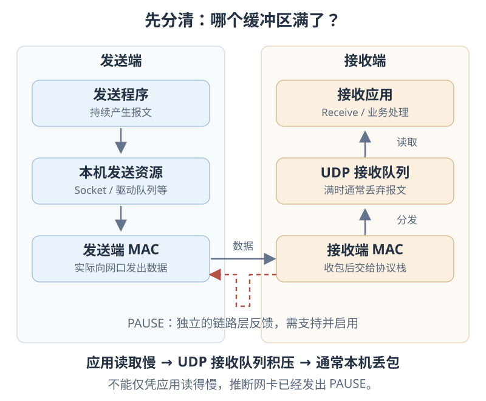
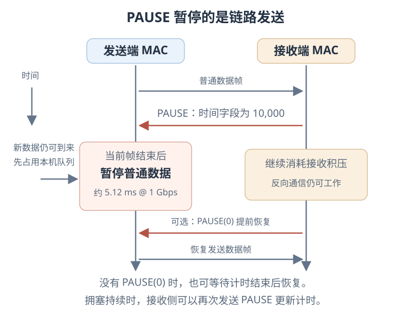

一台设备通过 UDP 持续上传数据，电脑上的程序负责接收和处理。程序偶尔忙不过来，来不及调用接收接口。设备会继续发送、等待电脑，还是把数据一直积压在自己的缓存中？

从“UDP 没有连接”出发，很容易得出两个相反的判断：发送端永远不会阻塞，或者接收端缓存满了就会让发送失败。问题在于，这两种判断都把 UDP 协议、操作系统和网卡当成了同一层。

**UDP 本身没有根据接收应用读取速度实施流量控制的机制；使用 UDP 的完整系统，仍可能在本机资源、应用协议或底层链路上受到限制。** 判断是否会停发、丢包或缓存满，需要把数据经过的队列和反馈路径逐一画出来。

## 接收端读得慢，报文去哪了 {#slow-receiver}

先限定一个常见情况：网络链路正常，接收程序已经绑定 UDP 端口，只是读取速度低于到达速度。

操作系统会先把接收到的报文放入对应的接收队列。应用通过 `Receive` 或 `ReceiveAsync` 从队列中取出报文；队列能容纳的数据有限，应用长期取不及时，就会发生丢包。应用后来恢复读取，也无法要求 UDP 自动补回已经丢失的报文。

这里积压的是**接收电脑上的数据**。UDP 没有 TCP 那样的接收窗口，也不会因为这个 Socket 的接收队列满了，就自动通知远端“这个应用来不及读，请先停一停”。UDP 应用如需可靠传输、接收确认或速率反馈，需要自己定义相应机制，参见 [RFC 768](https://www.rfc-editor.org/rfc/rfc768.html) 和 [RFC 8085](https://www.rfc-editor.org/rfc/rfc8085.html)。

<figure class="architecture-figure">
  <a href="/images/posts/udp-flow-control/buffer-layers.svg" target="_blank" rel="noopener"></a>
  <figcaption>画出队列的位置，再讨论“哪个缓冲区满了”。图中的发送队列是简化表示，不意味着所有系统都逐包复制经过完全相同的结构。</figcaption>
</figure>

下面几种情况也不能混为一谈：

| 接收端状态 | 常见结果 |
| --- | --- |
| 已绑定端口，暂时不读或读得慢 | 接收队列积压，超过可用容量后丢包 |
| 没有程序监听该端口 | 系统可能返回 ICMP“端口不可达”，也可能被策略过滤 |
| 报文被防火墙拦截或在途中丢失 | 发送端可能完全得不到反馈 |
| 应用读到了，但处理或写盘落后 | 数据可能继续积压在应用自己的队列里 |

“读得慢”也可能是下游传导的结果。例如接收线程先等一个空闲处理槽位，再调用 Socket 接收；处理槽位耗尽后，接收线程就暂时不读了。这个等待发生在本机，不能仅凭它推断远端发送也已暂停。微软的[丢包诊断说明](https://learn.microsoft.com/en-us/troubleshoot/windows-client/networking/diagnose-packet-loss)也将系统或 Socket 资源不足列为本地丢包原因。

## Send 成功，究竟完成了什么 {#send-success}

发送端至少有四个不同的完成边界：

1. 本机发送 API 成功完成。
2. 报文实际离开发送端网口。
3. 接收端协议栈接收报文，并交给相应 Socket。
4. 接收应用读出报文，并完成业务处理。

**第一个边界不能证明后面三个边界已经完成。** `Send` 成功时，报文可能已经发出，也可能仍有后续排队和传输过程。具体完成语义取决于 API 与系统实现，不宜把所有成功都精确解释为“刚刚复制进某一个发送缓冲区”。Windows 的 [`sendto` 文档](https://learn.microsoft.com/en-us/windows/win32/api/winsock2/nf-winsock2-sendto)明确说明：调用成功不代表数据已经成功送达。

在 .NET 中，`UdpClient.Send` 成功时返回发送字节数，失败通常抛出异常；它不是返回一个表示对端收到与否的布尔值。[API 文档](https://learn.microsoft.com/en-us/dotnet/api/system.net.sockets.udpclient.send?view=net-10.0)

UDP Socket 也可以调用 `Connect`，但这里主要是设置默认对端等本地行为，不会获得 TCP 的握手、可靠传输和接收窗口。因此，不能用这个调用是否成功来判断远端程序是否在线。[UdpClient.Connect 文档](https://learn.microsoft.com/en-us/dotnet/api/system.net.sockets.udpclient.connect?view=net-10.0)

如果业务真正需要确认“已经处理”，接收应用必须在对应业务阶段返回确认。操作系统收到了报文、应用读到了报文、结果写入数据库，是三个不同的确认含义。

## UDP 没有流控，网口为什么还能暂停 {#ethernet-pause}

UDP 工作在传输层，以太网 PAUSE 工作在更下面的链路层。网卡处理以太网帧时，可以对承载 UDP 的帧实施链路流控，不需要 UDP 自己提供确认机制。

以全双工以太网上的 IEEE 802.3x PAUSE 为例，在双方支持并启用相应能力时：

1. 接收侧网卡或控制器内部的接收资源达到触发条件，向相邻链路对端发送 PAUSE 控制帧。
2. 对端识别并响应 PAUSE，通常发完当前数据帧，再暂缓发送后续普通数据帧。链路保持连接，接收方向仍可工作，必要的控制帧处理也继续进行。
3. 暂停计时结束后恢复发送。接收侧还可以发出时间为零的 PAUSE 提前恢复，或在拥塞持续时继续发送 PAUSE 更新计时。

PAUSE 控制帧的 EtherType 为 `0x8808`，操作码为 `0x0001`。时间字段以 512 个比特的传输时间为单位：在 1 Gbps 链路上，单位时间为 0.512 µs，字段值 10,000 对应约 5.12 ms。相关识别、暂停与恢复行为可见 [Intel I219 数据手册第 58–60 页](https://cdrdv2-public.intel.com/612523/ethernet-connection-i219-datasheet.pdf#page=58)。

<figure class="architecture-figure">
  <a href="/images/posts/udp-flow-control/pause-sequence.svg" target="_blank" rel="noopener"></a>
  <figcaption>暂停作用于网口的实际发送动作。应用是否立即等待，取决于发送端后续还有多少可用排队资源。</figcaption>
</figure>

这里有一个关键边界：**UDP Socket 接收队列满，不等于网卡内部接收资源一定达到 PAUSE 阈值。** 操作系统完全可能在协议栈中丢弃报文，同时继续从网卡取走新到达的数据。只有进一步的资源竞争或拥塞确实影响到底层接收路径，才可能进入链路流控的触发条件。

另外，普通 PAUSE 是逐链路的，不是发送应用与接收应用之间的端到端协议。中间有交换机时，交换机不会简单地把收到的 PAUSE 原帧一路转发；它可以在自己的某条相邻链路上独立产生流控请求。[Junos 对链路流控的说明](https://networkingdocs.hpe.com/documentation/us/en/software/junos/traffic-mgmt-qfx/topics/concept/cos-qfx-series-congestion-notification-understanding.html)

## 暂停发送以后，Send 一定失败吗 {#send-pressure}

不一定。网口暂停后，发送应用可能仍在产生数据，而发送端的操作系统、驱动或设备内部还有可用队列。此时发送调用仍可能成功。

随着积压增加，后续行为由资源位置、API 模式和实现决定：

| 情况 | 调用方可能看到什么 |
| --- | --- |
| 本机仍有可用发送资源 | `Send` 继续成功，数据等待后续发送 |
| 阻塞 Socket 暂时没有可用发送空间 | 调用等待，等到资源可用后仍可能成功 |
| 非阻塞 Socket 无法立即完成 | 返回相应错误；Windows 常见为 `WouldBlock` |
| 系统无法提供所需资源 | 返回资源不足等错误，.NET 通常表现为异常 |
| API 已成功，但报文在后续队列或网络中被丢弃 | 之前的成功不会自动改成失败 |

Windows [`sendto`](https://learn.microsoft.com/en-us/windows/win32/api/winsock2/nf-winsock2-sendto) 对发送空间不足时的阻塞行为和非阻塞错误作了说明。这里讨论的是 UDP 发送调用对本机资源的等待，不能把它理解成 UDP 正在等待对端确认。

除此以外，Socket 已关闭、参数不合法、报文过大、本机检测到网络或路由不可达，都可能让发送失败。收到先前报文对应的 ICMP 错误，也可能在后续操作中表现出来；具体反馈与操作系统和 Socket 用法有关。

报文长度问题可参考之前的[《UDP 报文数据包长度》](/user-datagram-protocol/)。超过路径 MTU 与超过单个 UDP 报文允许的最大长度也不同：前者涉及分片或路径 MTU 机制，不能一概视为同一种发送错误。

把这条因果链写完整，应当是：**底层流控可能暂停网口，持续产生的数据随后可能使发送端积压；资源耗尽后，可能等待、报错或丢包。** 不能压缩成“接收端慢，所以 UDP 发送一定失败”。

## 一直在发送，设备缓存为什么还会满 {#device-buffer}

“仍在发送”和“发送得足够快”是两回事。对一个持续收集数据再转发的设备，应该比较同一口径下的实际输入字节率和实际输出字节率，而不是只看网口标称为 1 Gbps。

在缓存尚未溢出、一直非空且输入输出速率保持稳定的时间段，可以近似计算：

```text
缓存变化量 =（输入字节率 − 输出字节率）× 时间
```

例如，假设设备每秒输入 100 MB、实际发出 80 MB，那么每秒仍会增加 20 MB 积压。假如还剩 200 MB 可用缓存，按这个差额持续约 10 秒就可能耗尽。这里的数字是演算示例，MB 按十进制计算，不是某块板卡的实测容量或性能。

即使长期平均输出足够，突发输入或短时暂停也可能造成瞬时积压。有限缓存只能吸收一定规模的突发，不能无限补偿持续的速率差。

DCA1000 是一个容易引出这个问题的例子：TI 将 `DDR_FULL_LED` 解释为 LVDS 输入速率高于以太网输出速率。其发包间隔会改变理论输出能力：文档列出 5 µs 对应约 706 Mbps，25 µs 对应约 325 Mbps。因此，增大发包间隔可能减轻电脑侧的瞬时接收压力，同时也可能让板卡更容易积压。[TI 用户指南第 21 页、第 26 页](https://www.ti.com/lit/ug/spruij4a/spruij4a.pdf)

但这份文档并没有据此证明 DCA1000 的具体 FPGA 固件会响应 PAUSE。**通用以太网流控机制成立，不等于某块板卡的实现已经得到确认。** TI 官方也曾说明，其无法直接提供这套 FPGA 源码，需要向 Lattice 获取；只有 PC 侧 CLI 源码不能完成 MAC 行为核验。[TI 官方答复](https://e2e.ti.com/support/sensors-group/sensors/f/sensors-forum/1633129/iwrl6844-inquiry-on-availability-of-dca1000-evk-fpga-source-code-for-lvds-to-csi-logic-development)

所以设备侧的调查还需要：核对固件版本、确认配置应答是否成功、确认参数单位，并测量实际输入输出。源码里写了一个常量，并不能单独证明硬件已经采用了这个配置。

## 怎样确认流控真的发生了 {#diagnosis}

先判断拥塞所在的位置，再选择指标。

| 需要验证的事情 | 有用的证据 | 不能单独证明的事情 |
| --- | --- | --- |
| 应用处理跟不上 | 应用队列长度、槽位等待时间、处理耗时 | 网卡已经发送 PAUSE |
| 报文在本机被丢弃 | Socket／协议栈统计、丢包追踪、网卡丢弃计数 | 丢包一定来自同一个队列 |
| 电脑请求对端暂停 | 电脑的 `Tx PAUSE`、`XOFF Tx` 增量 | 对端已经响应请求 |
| 对端响应暂停 | 有效 PAUSE 到达对端的证据，以及对应的链路停发和恢复时序 | 业务数据已经完整接收 |
| 设备缓存持续增长 | 设备缓存指标或可比口径的输入输出测量 | 电脑应用读取慢就是直接原因 |

Windows 可以先查看网卡的高级配置，实际接口名按本机调整：

```powershell
Get-NetAdapterAdvancedProperty -Name "以太网" |
    Where-Object { $_.RegistryKeyword -in '*FlowControl', '*ReceiveBuffers' } |
    Format-Table DisplayName, DisplayValue

Get-NetAdapterStatistics -Name "以太网" | Format-List *
```

“接收缓冲区”选项可能是接收描述符数量，不是 Socket 接收缓冲区，也不等于 PAUSE 高水位。“自动协商”表示配置方式，不能单独证明发送 PAUSE 已在当前链路生效。[Intel 高级设置说明](https://www.intel.com/content/www/us/en/support/articles/000005593/ethernet-products.html)

`Get-NetAdapterStatistics` 提供丢弃、错误等统计，但不要假定所有网卡都会通过它暴露 PAUSE 专用计数。确切水位和专用统计通常需要相应的驱动诊断能力；在 Linux 上，部分驱动可以通过 `ethtool -a` 查看流控配置，通过 `ethtool -S` 查看统计，字段随驱动变化。[微软统计命令文档](https://learn.microsoft.com/en-us/powershell/module/netadapter/get-netadapterstatistics)、[Intel e1000e 驱动文档](https://www.kernel.org/doc/html/latest/networking/device_drivers/ethernet/intel/e1000e.html)

若使用交换机，可查看电脑所连端口的接收 PAUSE 计数，确认电脑是否发出请求；要判断交换机是否又暂停了设备，则需要继续查看设备所连端口的发送 PAUSE 和设备侧行为。注意区分观察位置和收发方向。

普通主机抓包未必能看到硬件生成或处理的所有控制帧，因此“抓包没看到”不能单独证明没有发生。需要验证物理链路时，应使用能观察相关控制帧的网卡诊断、交换机统计或链路测试设备。

## 禁用流控，能排除什么 {#disable-flow-control}

如果电脑与设备通过网线直连，在确认网卡**发送 PAUSE 的能力已禁用并生效**、链路重新建立且保持稳定后，可以排除“这张电脑网卡通过普通 PAUSE 要求设备暂停”的路径。直接选择 `Disabled` 通常同时关闭发送和响应；仅关闭接收 PAUSE，不等于禁止电脑发出 PAUSE。

如果经过交换机，单独禁用电脑网卡还不能排除交换机独立向设备发送 PAUSE。其他独立启用的优先级流控机制也需要另行核对，不能把一个设置当成所有机制的总开关。

这个实验只是在排除一条因果路径。电脑接收能力不足时仍然可能丢包，也不会因为关掉流控就自动变快。即使关掉之后设备缓存不再溢出，也应结合链路速率、发包配置和实际 PAUSE 证据，避免把重连时发生的其他变化误当成结论。

## 一个可以复现的回环实验 {#experiment}

为了验证 `Send` 与接收应用之间的边界，可以先做一个不涉及硬件的实验。配套代码在 [examples/udp-flow-control](https://github.com/luli100/luli100.github.io/tree/main/examples/udp-flow-control)，使用 .NET 10，不依赖第三方包。从仓库根目录运行：

```powershell
dotnet run --project examples/udp-flow-control/UdpFlowControl.csproj --configuration Release
```

程序只向 `127.0.0.1` 的临时端口发送人工构造的报文。先验证回环可正常通信，再让接收 Socket 在发送期间不执行读取，最后统计接收端剩余报文。另有闭端口观察和报文过大错误两个场景。

2026 年 11 月 16 日，在 Windows 10.0.26200、.NET 10.0.11 上的一次运行结果如下：

| 场景 | 观察结果 |
| --- | --- |
| 接收缓冲设置后返回 8192 字节，发送期间不读 | 20,000 个 1466 字节报文全部发送成功，耗时 168 ms；之后读出 6 个报文 |
| 临时端口释放后向其发送 | 20,000 次发送均成功；本次没有通过发送调用观察到 ICMP 对应异常 |
| 单次发送 65,508 字节的 IPv4 UDP 载荷 | 得到 `MessageSize`，Windows 原生错误码为 10040 |

保留 6 个报文只是这次运行的观察，不能据此推导所有系统的接收队列算法，也不能仅凭这张表逐包定位丢弃发生在哪一层。闭端口场景也不保证所有系统都会成功：ICMP 反馈方式可能不同。

这个实验明确验证了：**发送调用全部成功，并不保证接收应用获得全部报文；UDP 发送调用也确实可能报错。** 回环流量没有经过被讨论的物理以太网链路，因此它不验证网卡 PAUSE，更不能验证设备固件是否响应 PAUSE。

## 给工程判断补上条件 {#evidence}

下面三句话的含义不同：

- “UDP 接收应用读得慢，接收队列可能积压并丢包。”这是常见的接收侧行为。
- “以太网 PAUSE 可能暂停承载 UDP 的网口发送。”这是具备相应支持与配置时的链路机制。
- “某台电脑读取慢，已经通过 PAUSE 导致某块设备缓存满。”这是具体系统的故障判断，需要逐段证据。

要成立第三句话，至少需要把中间环节接起来：读取落后是否影响到底层接收资源，电脑或交换机是否真的发送 PAUSE，设备是否真的响应，暂停造成的实际输出下降是否足以解释缓存增长。

同样，“发送端缓存满了，所以 UDP `Send` 一定失败”也缺少条件。网卡、驱动和 Socket 是不同层的资源；调用可能等待、报错，也可能先成功而后丢包。一次 `Send` 的结果、一次接收的结果，以及一块设备的缓存状态，应分别测量和解释。
