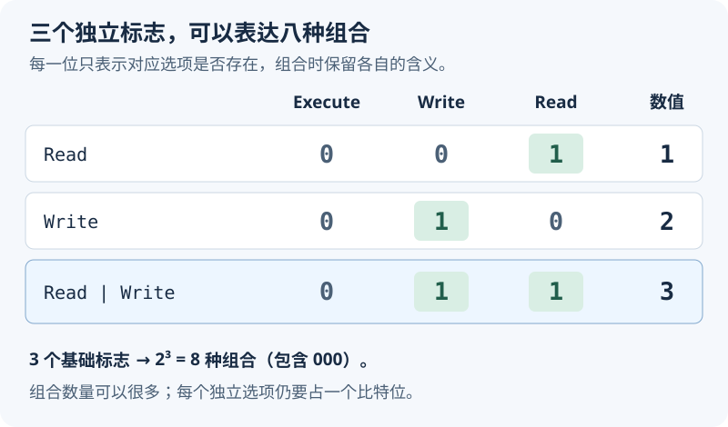

一个设备采集系统持续接入新型号，`DeviceCategory` 从 `1`、`2`、`4` 一路增加，最后用到了 `1 << 30`。继续扩展时，才发现同一个枚举既用来识别单个型号，又用来组合通道中的多个型号；它的数值还被写进了录制文件和数据库。

最后的改法是保留型号的历史编号，把多型号组合交给独立集合。这个案例引出了一个更普遍的设计问题：**哪些需求适合位枚举，怎样才能用好它？**

位枚举能够用一个整数表达一组开关，组合和检查也很直接。它的优势依赖一个前提：**选项数量可控，含义相对稳定，而且多个选项一起出现具有自然的业务意义。** 先判断这个前提，再决定怎样分配比特位。

## 位枚举的好处在哪里 {#flags-benefits}

以一组固定的操作权限为例：读、写、执行可以分别存在，也可以同时存在。给每个选项分配一个独立比特位：

```text
选项       Execute  Write  Read     数值
Read          0       0     1        1
Write         0       1     0        2
Execute       1       0     0        4
Read | Write  0       1     1        3
```

这里 `3` 表示“读和写同时存在”。它是一个有明确组合含义的值，不需要再为“读写”“读执行”“写执行”等每种情况分别设计新的身份编号。

位枚举主要带来四个好处：

- **表示紧凑。** 在选定的整数位宽内，用一个值携带多个布尔选项，适合参数、状态字和已有的二进制协议。
- **组合直接。** 用 `|` 合并选项，用 `&` 检查交集，用 `& ~` 清除选项，无需为每个组合编写分支。
- **表达有类型。** `AccessRights.Read` 比裸整数 `1` 更清楚，编译器也能区分不同枚举类型；通过整数强转进入的值仍需校验。
- **组合数量充分。** `n` 个独立比特可以表达 `2^n` 种组合，包含“全部关闭”；不必把每种组合声明成枚举成员。

**3 个标志能表达 8 种组合，不等于能分配 8 个独立标志。** 每增加一个独立选项，仍要消耗一个新的比特位。这正是位枚举的收益和容量限制同时存在的原因。

<figure class="architecture-figure">
  <a href="/images/posts/device-category-identity/flags-operations.svg" target="_blank" rel="noopener"></a>
  <figcaption>每一位回答一个“是否具备”的问题，整个值表达这些答案的组合。</figcaption>
</figure>

这些位运算本身很简单，但不能由此推断整个程序一定更快。相对于几个布尔字段或一个集合，实际收益还取决于对象布局、数据规模和访问方式。涉及性能目标时应测量，不能只凭“底层是位运算”作判断。

## 普通枚举、位枚举还是集合 {#choose-representation}

选型可以从“这个字段究竟在表达什么”开始：

| 表示方式 | 适用需求与例子 |
| --- | --- |
| 普通枚举 | 一次只选一个状态或种类，如任务状态、压缩等级、单台设备型号；组合值没有所需的含义 |
| 位枚举 | 数量可控、可组合的一组开关，如一次文件操作的权限、小而稳定的解析选项、协议定义的状态位 |
| 标识加集合 | 多个对象或标识，成员可能持续增加，如已选设备、用户所属的角色、插件清单 |
| 配置对象 | 不同维度各有一个取值，或组合约束很多，如压缩算法加压缩等级；将维度分别建模 |
| 集合与对象 | 成员还带数量、顺序或其他参数，如按顺序执行的处理步骤、每个目标各自的阈值 |

一个实用的判断标准是：**能否把每个基础标志解释成同一个问题域下、可以同时成立的“是或否”？** 还要核对未来的数量上限，是否由同一套代码或协议控制，以及大部分组合是否都有意义。

例如，“读”和“写”可以同时成立；“任务正在排队”和“任务已经完成”通常应放在互斥的状态枚举中。如果同一个位枚举里到处出现“选了 A 就不能选 B，选了 C 又必须选 D”，应当重新检查是否把不同维度或不同状态塞到了一起。

“权限”也不是一律适合位枚举。编译期确定的一小组操作能力可以用位表示；管理员动态创建的角色、不断加入的资源和用户授权关系，通常仍需要标识、集合及相应规则。同样，几项固定处理选项适合位枚举，并不意味着一个动态功能开关平台也应把所有开关塞进整数。

## 怎样定义一个清楚的位枚举 {#define-flags}

下面是一组简化的操作权限：

```csharp
[Flags]
public enum AccessRights : int
{
    None = 0,
    Read = 1 << 0,
    Write = 1 << 1,
    Execute = 1 << 2,

    ReadWrite = Read | Write,
    All = Read | Write | Execute
}
```

这里有几个值得固定下来的约定：

- **基础标志各占一位。** 使用 `1`、`2`、`4` 等 2 的幂；`3` 可以表示组合，但不能再当作一个与 `1`、`2` 独立的基础标志。
- **零值表示全部关闭。** `None = 0` 不占任何位。若业务中的“自动”或“默认”有额外含义，先明确它与空组合的区别。
- **常用组合通过已有成员组合。** `ReadWrite` 是别名，不是新增能力。不要为了命名一个组合，另外消耗一个比特位。
- **名称表达组合性质。** 自己设计的新类型可采用 `AccessRights`、`ParseOptions` 这类复数形式，让调用者容易看出它能同时包含多个选项。

这些基础约定与微软的 [Enum Design 指南](https://learn.microsoft.com/en-us/dotnet/standard/design-guidelines/enum#designing-flag-enums)一致。`[Flags]` 用于声明这种组合意图，也影响枚举的字符串格式；它不会自动替你分配 2 的幂，也不会禁止未声明的整数值或不合理组合。

底层类型通常从默认的 `int` 开始。若固定协议要求别的宽度，或者确实需要更多独立位，再明确选择 `uint`、`long` 或 `ulong`，并核对所有消费端。使用高位时，移位左操作数也要匹配，例如 `1UL << 40`；把接收结果的类型改成 `ulong`，不会让 `1 << 40` 先按 64 位计算。[C# 移位运算说明](https://learn.microsoft.com/en-us/dotnet/csharp/language-reference/operators/bitwise-and-shift-operators#shift-count-of-the-shift-operators)

## 分清全部包含、任一包含与完全相等 {#operate-flags}

设当前拥有读写权限，需要检查读或执行权限：

```csharp
AccessRights rights = AccessRights.Read | AccessRights.Write;
AccessRights requested = AccessRights.Read | AccessRights.Execute;

// requested 中的每一位都具备吗？false
bool hasAll = (rights & requested) == requested;

// requested 中至少有一位具备吗？true
bool hasAny = (rights & requested) != AccessRights.None;

// 当前值是否恰好只有 Read？false，因为还有 Write。
bool exactlyRead = rights == AccessRights.Read;

rights |= AccessRights.Execute;  // 加上执行权限，得到 7。
rights &= ~AccessRights.Write;   // 清除写权限，得到 5。
```

这三种判断回答不同问题。检查某个权限是否存在，若误写成 `rights == AccessRights.Read`，组合值就会被误判。

`rights.HasFlag(requested)` 的含义是“全部包含”，对应 `(rights & requested) == requested`，不是“至少包含一个”。参数为零时，它还会返回 `true`：

```csharp
bool noRights = rights == AccessRights.None;

// true；不能用它判断“当前没有任何权限”。
bool containsNone = rights.HasFlag(AccessRights.None);
```

这符合空集合被任意集合包含的直觉。若业务要求“请求至少一项，且这些项全部具备”，要另外检查 `requested != AccessRights.None`。[Enum.HasFlag 文档](https://learn.microsoft.com/en-us/dotnet/api/system.enum.hasflag?view=net-10.0)

读取时讲清包含语义，修改时讲清目标状态。设置用 `|`，清除用 `& ~`；`^` 表示翻转，重复执行会再次改变状态，只在确实需要切换时使用。

## 定义过的名称，不等于合法的组合 {#validate-flags}

普通枚举经常用 `Enum.IsDefined` 检查某个值是否已经声明。位枚举需要多想一步：一个组合即使只使用了已知位，也可能没有单独的名称。

```csharp
AccessRights readExecute = AccessRights.Read | AccessRights.Execute;

// false：上面的枚举没有声明数值为 5 的成员。
bool hasDeclaredName = Enum.IsDefined(readExecute);
```

因此，不能直接用它判断位组合是否合法。这里的“是否合法”至少分为两层：

1. **编码是否只包含已知位。** 例如 `5` 使用读和执行，`8` 使用了当前未定义的第四位。
2. **业务是否允许这个组合。** 位都已知，仍不代表当前操作、对象或调用者允许使用它们。

[Enum.IsDefined 的文档](https://learn.microsoft.com/en-us/dotnet/api/system.enum.isdefined?view=net-10.0#remarks)也说明，它检查的是已声明的值，而不是自动验证所有可组合的标志。对上面的权限类型，可以这样检查已知位：

```csharp
static bool HasOnlyKnownRights(AccessRights value) =>
    (value & ~AccessRights.All) == AccessRights.None;

bool knownCombination = HasOnlyKnownRights(readExecute); // true
bool unknownBits = HasOnlyKnownRights((AccessRights)8);  // false
```

这段检查允许 `None`。如果业务不允许空权限，应再明确检查非零；如果某个 API 只允许读权限，也要用该 API 的允许范围继续校验，不能把“全局认识这个位”当成“这里可以使用”。

`Enum.GetValues<AccessRights>()` 也需要留意：它返回声明的常量值，包含 `None`、`ReadWrite`、`All`，不是只返回三个基础标志。制作复选框列表时，应显式列出可选基础项或按约定筛选，避免把组合别名当成新的独立选项。[Enum.GetValues 文档](https://learn.microsoft.com/en-us/dotnet/api/system.enum.getvalues?view=net-10.0)

## 位枚举进入文件和协议以后 {#evolve-flags}

位枚举很适合携带固定状态字，但一旦写进持久化数据或跨进程协议，每个位的含义就成为兼容契约。后续扩展需要考虑：

| 事项 | 实践建议 |
| --- | --- |
| 位值 | 保持含义；停用后不重新分给其他含义，避免旧数据被重新解释 |
| 编码 | 明确位宽、符号以及二进制字节序；不能只改 C# 类型就认为协议已经升级 |
| 未知位 | 按 API 或协议约定选择拒绝、忽略或保留；授权入口不能让未知位意外获得权限，转发器也不应擅自丢掉需保留的信息 |
| `All` | 明确是“当前已知全部项”，还是某个固定版本的集合；新增一位后，旧程序中的 `All` 不会自动认识它 |
| 序列化 | 数字掩码可以是合理格式，但必须约定含义；显示名称和 `ToString()` 的输出不宜临时充当持久协议 |

尤其不要随手写 `All = -1` 来表示“当前所有权限”。它会把底层整数的每一位都设为 `1`，包括尚未定义的位。若需要“当前已知位”，就显式组合这些位；若协议确实规定全位掩码，则把特殊语义写清楚，并相应调整验证方式。

在编译后的调用方、数据库旧记录和历史文件里，“全部”也不会因为源码新增一个成员就自动变化。例如旧值 `7` 只包含前三位，新增第四位后仍是 `7`，不会自己变成 `15`。权限扩展尤其需要明确既有授权是否应获得新能力，不能由一个 `All` 的名字替业务作决定。

## 回到设备型号的例子 {#revisit-case}

开头的系统中，单台设备需要的是一个稳定型号编号，共享通道需要的是多个型号组成的集合。型号目录持续增长，用“每个型号占一位”把身份分配绑到了集合容量上，于是最终耗尽正数位。

这次拆分保留了单型号的 `Int32` 编号，用独立集合表达多个型号。旧编号和录制文件中的 4 字节型号字段保留；旧通道整数仍按历史掩码读取，新集合统一写数组。

这个迁移有一个很好的验证输入：`3`。

| 数据所在的约定 | `3` 的含义 |
| --- | --- |
| 旧通道掩码 `3` | 两个型号：`1` 和 `2` |
| 新通道数组 `[3]` | 一个独立型号：编号 `3` |

它能区分“仍在拆位”与“按独立编号处理”，而 `1`、`2`、`4` 这样的输入无法有效区分。验证时只在隔离源码副本中把已有型号暂时映射成 `3`，重新编译真实转换器、解析器和回放服务，再用生成的 CAN 输入执行链路；正式历史编号没有修改，实机采集也没有因此被宣称已验收。

这个案例说明：**位枚举很擅长表达一组受控的开关；对象身份和持续增长的目录，需要另外评估表示方法。** 如果成员还要由用户、插件或配置动态注册，连普通枚举也可能不合适，应使用稳定标识与注册表等机制。

## 一份可以用于代码评审的清单 {#review-checklist}

| 检查项 | 应当能够明确回答的问题 |
| --- | --- |
| 语义 | 这些项可以同时成立吗？主要组合是否自然、有意义？ |
| 范围 | 成员是否由代码或协议控制，未来能否容纳在既定位宽里？ |
| 定义 | 是否标记 `[Flags]`，基础位互不重叠，零值确实表示全部关闭？ |
| 操作 | 每个判断需要全部包含、任一包含，还是完全相等？ |
| 校验 | 未知位、空组合和业务限制是否分别处理？ |
| 展示 | 枚举常量中的零值与组合别名，会不会被误当成新的基础选项？ |
| 演进 | 持久化位值是否稳定？旧程序看到新位时怎么处理？`All` 的范围是否清楚？ |
| 验证 | 是否覆盖零值、单项、未命名的多项组合、未知位，以及清除后其他位仍然保留？ |

最佳实践并不是把所有集合都压成整数，也不是遇到扩展就放弃位枚举。先确认每一位代表的业务问题，再让定义、操作和边界约定保持一致，位枚举的紧凑与直接才会成为长期的收益。
