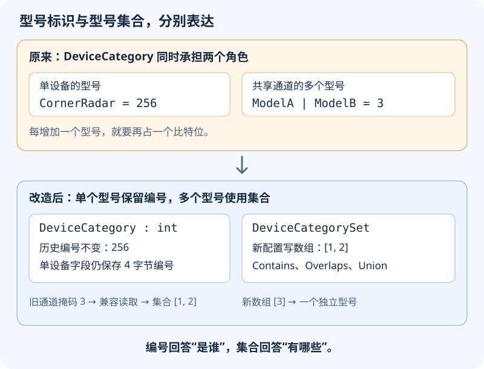

一个设备采集系统不断接入新型号，`DeviceCategory` 枚举也跟着增加。最初只有几个值，后来越来越长，最后一项已经写到了 `1 << 30`。

此时再加一个型号，问题就来了：下一位是符号位，再往后也没有新的位可用。看上去只是 `int` 不够宽，改成 `long` 好像就能继续。

沿着引用查下去，才发现这个枚举既表示**某一台设备的型号**，又表示**一个通道包含的多个型号**；数值还被写进了配置文件、录制文件头和数据库。一个省事的表示方法，逐渐变成了整个系统的兼容约定。

**这次改动的关键，是让单个型号继续使用稳定编号，让多个型号使用独立集合。** 旧数据的编号和二进制布局保留，新的组合方式在边界上明确区分。

下面使用简化的类型和型号名称说明问题，省略项目、客户及设备细节。代码中的 `3` 是演示和隔离回归使用的编号，并没有借这次修改重编号已有型号。

## 问题从第 31 个正数标志暴露出来 {#exhausted-bits}

原来的定义大致如下，中间省略了其他型号：

```csharp
[Flags]
public enum DeviceCategory : int
{
    None = 0,
    ModelA = 1,
    ModelB = 2,
    CornerRadar = 256,
    LatestModel = 1 << 30
}
```

每个型号占一位，通道接了多个型号就按位或：

```csharp
DeviceCategory categories =
    DeviceCategory.ModelA | DeviceCategory.ModelB;

bool containsModelA = categories.HasFlag(DeviceCategory.ModelA);
```

在“所有型号必须是正数、每个型号独占一位”的约定下，`Int32` 能提供 31 个这样的基础标志，最后一个是 `1 << 30`，即 `1_073_741_824`。`Int32` 本身有 32 位，符号位也能参与位运算；只是使用它会得到负数，还要核对系统中对负值的处理，即使可用也只多出一个位置。

还有一个容易误判的地方：在 C# 中，`1 << 31` 得到负数，`1 << 32` 则会再次得到 `1`，不会自动扩成更大的整数。对 `int` 的移位次数，只使用右操作数的低 5 位，参见微软的[移位运算说明](https://learn.microsoft.com/en-us/dotnet/csharp/language-reference/operators/bitwise-and-shift-operators#shift-count-of-the-shift-operators)。继续往枚举后面补移位表达式，甚至可能造成编号重复。

位数耗尽只是最先看得见的症状。更早埋下的问题，是系统把“型号有多少种”限制成了“一个整数有多少位”。

## 同一个类型，承担了两种含义 {#identity-and-set}

采集系统里，有两个都合理的需求：

| 位置 | 需要表达什么 | 例子 |
| --- | --- | --- |
| 一台设备的配置、一帧解析结果 | 一个确定的型号 | 这台设备是 `CornerRadar` |
| 共享通道配置、解析器支持范围 | 多个型号组成的集合 | 这个通道同时传输雷达和车身数据 |

问题出在，它们都使用了 `DeviceCategory`。看到一个变量时，调用者需要靠位置和习惯判断：这里能不能放组合值？应该用 `==`，还是 `HasFlag`？这个数值写进文件后，到底是型号编号还是掩码？

设备型号是一个身份。编号 `256` 的作用是识别某种型号，并不要求它在二进制中只有一位为 `1`。通道需要表达多个身份，才涉及集合操作。

微软的[枚举类型说明](https://learn.microsoft.com/en-us/dotnet/csharp/language-reference/builtin-types/enum#enumeration-types-as-bit-flags)区分了普通枚举与位标志的用途。位标志适合直接表达可组合的选项，例如读、写、执行权限。设备型号也可以用位来编码集合，但这样会把**型号身份的分配规则**和**集合的存储方式**绑在一起。对于持续增加的型号目录，这个约束逐渐成了负担。

<figure class="architecture-figure">
  <a href="/images/posts/device-category-identity/identity-and-set.svg" target="_blank" rel="noopener"></a>
  <figcaption>类型分工明确以后，型号增加不再消耗集合中的一个固定比特位。</figcaption>
</figure>

这里也不能只删掉 `[Flags]` 就宣布完成。C# 仍然允许对枚举使用按位运算，旧的 `|`、`&` 和 `HasFlag` 不会因为删掉特性就自动变成正确的集合操作。必须核对实际使用位置，改变承担集合含义的那些字段及其调用方式。

## 为什么没有直接改成 long {#compatibility}

如果这个值只在进程内使用，扩大底层类型可能是一个成本可控的选择。但在这个系统里，它已经越过了多个边界：

| 边界 | 已经存在的约定 | 随意改动的后果 |
| --- | --- | --- |
| JSON 通道配置 | 一个整数表示历史型号掩码 | 同一个整数可能被新旧代码解释成不同含义 |
| 单设备录制文件 | 22 字节文件头；从偏移 9 开始，用 4 字节保存型号 | 改成 8 字节会影响后续字段的位置及读取方式 |
| 数据库存储 | 整数保存单设备型号编号 | 重编号后，旧记录可能对应错误的型号 |
| 跨进程通信 | 固定参数布局与命令约定 | 只升级一端，另一端可能无法正确解包 |
| 文件命名与解析器选择 | 依赖型号名称、编号或精确匹配 | 局部转换成功，不代表其他消费端仍然正确 |

`long` 可以增加可用位数，但仍然要求每个新型号占一个比特位，也需要对这些边界逐一迁移。它延后了容量问题，没有解除型号编号对位掩码的依赖。

这次选择保留 `Int32`，因为**单个型号的编号空间远没有用完**。原来的限制来自“一种型号占一位”，而不是“一个整数只能保存几十种型号”。把集合拆出去后，新型号可以使用尚未分配的普通整数，不必继续取 2 的幂。

保留 `Int32` 也不是无限扩展的承诺。编号分配、停用与禁止复用仍然需要规则；如果未来真的需要更大的编号空间，再按版本迁移协议。当前没有必要为了改变集合表达，连单设备编号格式一起扩大。

## 拆开标识和集合，保留历史编号 {#separate-types}

新的职责分成两部分：

```csharp
// 单个型号：已有名称和数值保持不变，移除 [Flags]。
public enum DeviceCategory : int
{
    None = 0,
    ModelA = 1,
    ModelB = 2,
    CornerRadar = 256,
    LatestModel = 1 << 30
}

// 字段声明的示意，分别位于设备配置和通道配置中。
public DeviceCategory Model { get; set; }
public DeviceCategorySet SupportedModels { get; set; }
```

`DeviceCategorySet` 封装一个只读集合，提供 `Contains`、`Overlaps`、`Add`、`Union`、`Replace` 等操作。修改操作返回新集合，避免共享配置被某个调用者原地改变；集合相等按成员判断，不依赖加入顺序。

调用代码也随之表达自己的意图：

```csharp
var supported = new DeviceCategorySet(
    DeviceCategory.ModelA,
    DeviceCategory.CornerRadar);

bool canParse = supported.Contains(DeviceCategory.CornerRadar);
DeviceCategorySet expanded = supported.Add(DeviceCategory.ModelB);

// 此处业务要求通道中只能有一个型号。
DeviceCategory model = channel.DevCat.SingleCategory;
```

最后一行需要一个明确约定：本次实现中，空集合返回 `None`，恰好一个成员时返回该型号，多个成员时抛出异常。业务如果要求“必须恰好一个且不能为 None”，还要在相应入口校验。

不能从多型号集合中随便拿第一个成员，假装它就是这份数据的型号。那会把原先混用的风险藏进一个看起来方便的方法里。

历史型号依然保留 `1`、`2`、`256` 等原值，即使它们看起来不连续。**进入文件和数据库的枚举值，已经承担持久化标识的职责。** 重新排号会改变旧数据的解释，不能作为代码整理顺便完成；停用编号也不应重新分给别的型号。

## 旧值 3 和新值 3，怎样区分 {#serialization-boundary}

拆开内存类型以后，还有一个更隐蔽的冲突。

旧通道配置中的 `3` 表示两个型号：`1 | 2`。新设计允许一个型号的编号正好为 `3`。如果仍然只写一个整数，读取端没有足够的信息判断它是哪一种意思。

这次用 JSON 的结构区分两种含义。下面的片段都针对**通道中的型号集合字段**，不是单设备的型号字段：

| JSON 片段 | 读取含义 |
| --- | --- |
| `"DevCat": 3` | 旧整数掩码，按历史位拆成型号 `1` 和 `2` |
| `"DevCat": "3"` | 历史数字字符串，同样按掩码读取 |
| `"DevCat": [1, 2]` | 新数组，包含两个独立型号编号 |
| `"DevCat": [3]` | 新数组，只包含编号为 `3` 的一个型号 |

**旧格式按旧规则读取，新格式统一写数组。数组里的每一个数都是完整编号，不能再拆位。** 即使集合只有一个成员，也写成 `[256]`，不为了少一对方括号又回退成含义不清的整数。

旧掩码的读取规则也必须固定为历史位含义，不能随着新的枚举成员增加而重新推导。例如以后出现普通编号 `3`，就不能把旧掩码 `3` 当成它。历史名称字符串需要兼容时，也要保留对应的旧名称解释。

项目里同时使用 Newtonsoft.Json 和 System.Text.Json，因此两条序列化路径采用同样的边界，并分别验证。只修其中一个，仍可能在其他入口重新写出或误读旧语义。

二进制跨进程通信则需要另一种区分手段：旧命令继续按旧参数布局解析，新命令携带明确的型号数组。不要在原命令里悄悄替换固定结构，然后寄希望于另一端猜出版本。

这里的兼容是有方向的：**新程序可以读取既有数据，不代表旧程序能读取新数组或理解新型号。** 保存了新格式配置以后，旧版工具可能不再适用；跨进程组件也需要配套升级。发布前要核对这些消费端，回退时保留原始配置与录制数据，不能把“历史数据还能用”扩大成“任意版本都能互相读写”。

对已有录制数据，本次不重新编号、不批量改写原文件，单设备文件头仍保存原来的 4 字节编号。读取旧配置时在内存中转换集合。是否需要重新转换数据，应由具体数据处理变化决定，不能因为换了配置类型就要求重录历史数据。

## 用一个会撞上旧假设的编号做回归 {#adversarial-regression}

如果回归测试一直使用 `1`、`2`、`4`、`256`，很多残留的位运算也会通过：这些数既是合法的型号编号，又恰好是单比特标志，无法区分两种实现。

因此这次特意选择了 `3`。

```text
作为旧掩码：3 = 1 | 2，是两个型号。
作为新编号：[3] 只有一个成员，是一个型号。
```

最初的集合测试把 `(DeviceCategory)3` 放进数组，验证了序列化往返后它没有被拆开。这证明了集合和 JSON 边界的行为，但还不能证明完整链路已经支持普通编号。

原因是，生产解析器还会检查枚举成员是否已定义，并通过型号选择转换器。C# 允许把未定义的整数强制转换成枚举值，但它并不会因此成为已声明的型号；这一点可参考[枚举转换说明](https://learn.microsoft.com/en-us/dotnet/csharp/language-reference/builtin-types/enum#conversions)。一个能在集合中保存的值，未必能通过真正的解析入口。

为了验证这条链路，同时不改变正式型号编号，进一步使用了隔离源码快照：

1. 从明确的 Git 提交导出源码，把已有型号的编号仅在临时副本里从 `256` 改成 `3`。
2. 重新编译真实的转换器、解析器和回放服务，不使用替代它们的假实现。
3. 生成 CAN 输入与新数组配置，执行转换，读取生成的 CREC 文件，再按 `0 → 2 → 1` 的顺序跳转回放。
4. 检查文件头编号、帧计数、目标标识、解析结果与回放通道中的型号一致，确认没有冒出编号 `1`、`2` 对应的旧型号。
5. 比较输入录制的哈希和配置原始字节，确认过程没有改写输入；保留日志和测试结果，完成后清理临时副本。

正式源码中的历史编号仍是 `256`。普通构建下，另外分别验证旧整数配置和新数组配置；历史配置样本、固定编号断言与文件头布局测试也承担各自的兼容检查。

这次补充验证时，回放测试集 **113 项全部通过**，隔离副本中编号 `3` 的 CAN 端到端用例也通过。但这个结果有明确范围：输入是生成的 CAN 数据，不能据此宣布真实硬件采集、新旧网关混合部署或所有其他数据链路均已验收。

**测试数据要能够区分新旧实现。** 这里最有价值的输入，是一个会让旧假设暴露出来的普通整数，而不是再补一个 2 的幂。

## 分两步实施，也分清完成边界 {#rollout}

这类迁移适合把代码改造和兼容验证分成两步推进：

| 步骤 | 主要工作 | 完成依据 |
| --- | --- | --- |
| 第一步：改造类型与使用位置 | 保留单型号编号；引入集合；调整通道、转换、解析、回放及跨进程边界 | 相关模块构建通过，调用位置与新语义一致 |
| 第二步：验证历史与新编号 | 核对旧配置、编号和文件布局；用普通整数编号执行真实软件链路 | 各项兼容证据与链路测试通过，并列明未覆盖范围 |

改类型时沿着生产和消费关系检查，比只搜索类型定义更有效：谁创建配置，谁序列化，谁跨进程发送，谁写文件，谁读文件，谁根据它选择解析器？一条路径里的每个环节，都可能保留“型号就是一个比特位”的假设。

交付状态也需要准确描述。构建通过只能证明代码能编译；软件回归通过有自己的数据与链路范围；实机验收需要真实设备证据；发布生效还需要核对实际部署版本。它们分别回答不同问题。

这次另一个教训，是不能把“类型已经拆开”和“集合单元测试通过”合并表述成“第二步已经全部完成”。如果非 2 次幂编号还没进入真正的转换和解析链路，就应继续补齐；如果实机条件尚不具备，就明确留下验收项。

## 下次设计枚举前，先问这些问题 {#lessons}

回头看，这个设计在型号很少时使用方便，也长期没有触发容量问题。等到可用位接近耗尽，相关假设已经分散到了很多模块，修改成本远超过一个枚举定义。

今后设计或审查类似类型时，可以先问：

- **一个值表示一个身份，还是一组可同时成立的选项？** 如果两种含义都存在，用不同类型表达。
- **成员数量的增长是否适合固定位宽？** 持续扩展的型号目录，不应轻易绑定到一个整数的位数。
- **编号是否会离开当前进程？** 进入配置、文件、数据库或协议后，就要按兼容契约维护，不能随意排号或复用。
- **新旧含义能否从数据中明确区分？** 使用数组、版本字段或新命令等明确结构，避免让同一个数字靠上下文猜测。
- **测试是否真的推翻了旧假设？** 只用历史上的规则输入，可能一直发现不了遗留的旧算法。
- **完成结论是否超出了证据？** 把构建、软件回归、实机验收和发布状态分别说清楚。

位标志仍然适合小而明确的组合选项，稳定整数也仍然适合表示单个型号。这次设计调整的价值，在于把它们放回各自承担的职责中：让编号回答“是谁”，让集合回答“有哪些”，让历史数据在明确的兼容规则下继续被正确解释。
